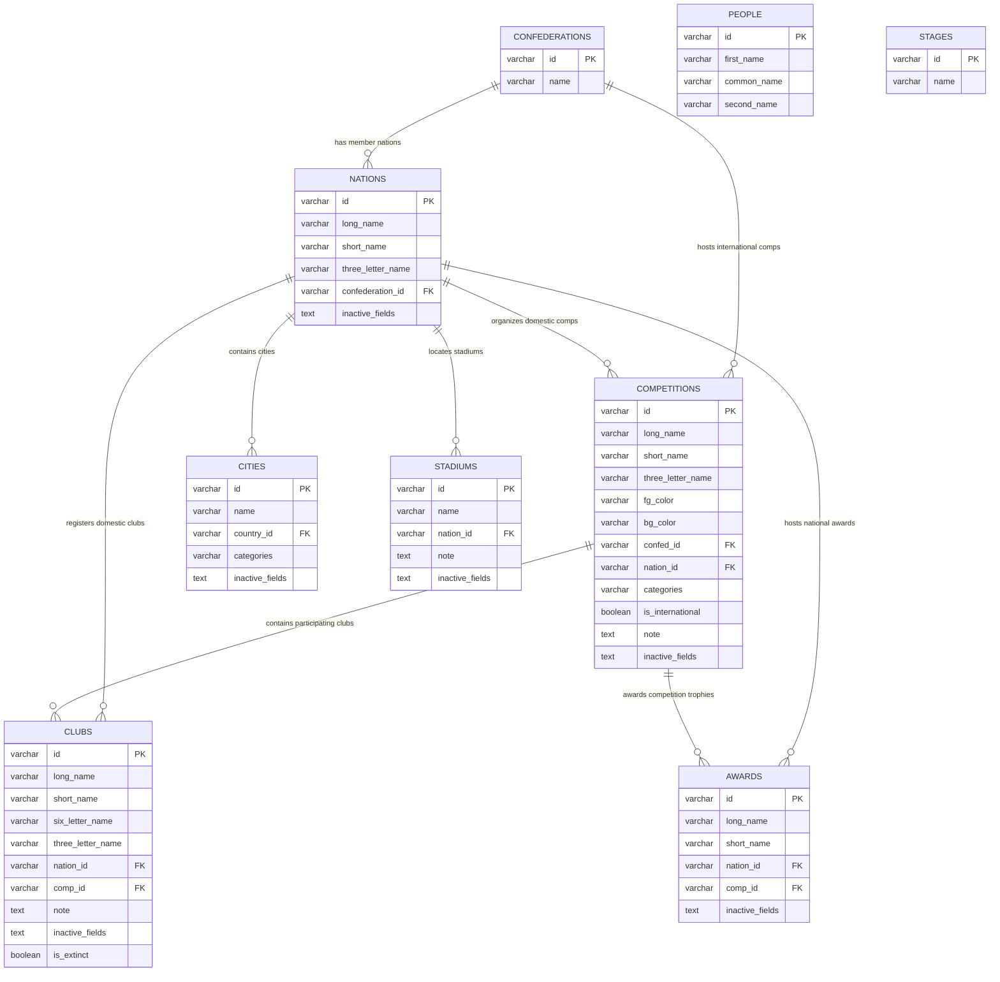

# TÀI LIỆU THIẾT KẾ CƠ SỞ DỮ LIỆU (DATABASE DESIGN SPECIFICATION)
## HỆ THỐNG QUẢN LÝ DỮ LIỆU FOOTBALL MANAGER (.LNC MANAGER)

- **Hệ quản trị CSDL:** PostgreSQL (>= 14)
- **Framework ORM:** TypeORM (NestJS)
- **Quy ước ID:** Chuỗi ký tự (`VARCHAR(64)` / `string`) cho toàn bộ Primary Key và Foreign Key.
- **Mục đích:** Lưu trữ, phân cấp hóa cấu trúc và đồng bộ 2 chiều dữ liệu bản quyền, đổi tên, màu sắc của Football Manager thông qua các tệp tin `.lnc` (Licence/Name Changes).
- **Vị trí tài liệu:** `DATABASE_DESIGN.md`

---

## 1. TỔNG QUAN VÀ MÔ HÌNH CÂY PHÂN CẤP (HIERARCHY TREE)

Cấu trúc dữ liệu trong Football Manager vận hành theo mô hình quan hệ hình cây chặt chẽ:

```
[Confederation / World] (Châu lục / Toàn cầu)
   │
   ├──> [International Competitions] (Giải quốc tế: UCL, World Cup, Copa Libertadores, v.v.)
   │        ├──> [Clubs] (CLB tham gia giải quốc tế)
   │        └──> [Awards] (Giải thưởng thuộc giải quốc tế: Cầu thủ xuất sắc nhất UCL)
   │
   └──> [Nations] (Quốc gia thành viên)
            ├──> [Domestic Competitions] (Giải quốc nội: Ngoại hạng Anh, V-League, v.v.)
            │        ├──> [Clubs] (CLB trực thuộc giải đấu)
            │        └──> [Awards] (Giải thưởng trực thuộc giải đấu)
            ├──> [Independent Clubs] (CLB độc lập / phong trào không gắn giải cố định)
            ├──> [Extinct Clubs] (CLB đã giải thể: is_extinct = true)
            ├──> [Stadiums] (Sân vận động thuộc quốc gia)
            ├──> [Cities] (Thành phố thuộc quốc gia)
            └──> [Independent Awards] (Giải thưởng độc lập cấp quốc gia)

[Global Directory] (Các thực thể dùng chung toàn cầu)
   ├──> [People] (Cầu thủ, HLV, trọng tài, giám đốc)
   └──> [Stages] (Tên gọi các vòng đấu / giai đoạn giải đấu)
```

---

## 2. SƠ ĐỒ QUAN HỆ THỰC THỂ (ENTITY RELATIONSHIP DIAGRAM - ERD)



---

## 3. THIẾT KẾ CHI TIẾT TỪNG BẢNG (TABLE SPECIFICATIONS)

### 3.1. Bảng `confederations` (Châu lục / Liên đoàn bóng đá)
- **Mục đích:** Lưu trữ các liên đoàn cấp châu lục (UEFA, AFC, CONMEBOL, CONCACAF, CAF, OFC) hoặc liên đoàn toàn cầu (FIFA / WORLD).
- **Quy ước ID:** ID chuỗi (`VARCHAR(64)`), e.g. `'1'`, `'2'`, `'7'`.

| Tên cột | Kiểu dữ liệu | Khóa | Nullable | Mặc định | Ý nghĩa & Ghi chú |
| :--- | :--- | :---: | :---: | :--- | :--- |
| `id` | `VARCHAR(64)` | **PK** | No | | Unique Game ID của Châu lục / Liên đoàn (String) |
| `name` | `VARCHAR(255)` | | No | | Tên liên đoàn (e.g. `Europe`, `Asia`, `World`) |

---

### 3.2. Bảng `nations` (Quốc gia)
- **Mục đích:** Quản lý quốc gia thành viên, tên đầy đủ, tên viết tắt, mã 3 ký tự (ISO/FM code).

| Tên cột | Kiểu dữ liệu | Khóa | Nullable | Mặc định | Ý nghĩa & Ghi chú |
| :--- | :--- | :---: | :---: | :--- | :--- |
| `id` | `VARCHAR(64)` | **PK** | No | | Unique Game ID quốc gia trong Football Manager (String) |
| `long_name` | `VARCHAR(255)` | | No | | Tên quốc gia đầy đủ (e.g. `Vietnam`, `England`) |
| `short_name` | `VARCHAR(255)` | | No | | Tên rút gọn (e.g. `Vietnam`, `England`) |
| `three_letter_name` | `VARCHAR(50)` | | No | | Mã 3 ký tự (e.g. `VIE`, `ENG`, `FRA`) |
| `confederation_id` | `VARCHAR(64)` | **FK** | Yes | `NULL` | Tham chiếu tới `confederations.id` (ON DELETE SET NULL) |
| `inactive_fields` | `TEXT` | | Yes | `NULL` | Danh sách các trường bị vô hiệu hóa khi xuất file `.lnc` |

---

### 3.3. Bảng `competitions` (Giải đấu)
- **Mục đích:** Quản lý cả giải đấu quốc tế (UEFA Champions League, World Cup) và giải quốc nội (Premier League, V-League 1).

| Tên cột | Kiểu dữ liệu | Khóa | Nullable | Mặc định | Ý nghĩa & Ghi chú |
| :--- | :--- | :---: | :---: | :--- | :--- |
| `id` | `VARCHAR(64)` | **PK** | No | | Unique Game ID của giải đấu (String) |
| `long_name` | `VARCHAR(255)` | | No | | Tên giải đấu đầy đủ (e.g. `English Premier Division`) |
| `short_name` | `VARCHAR(255)` | | No | | Tên rút gọn giải đấu (e.g. `Premier League`) |
| `three_letter_name` | `VARCHAR(50)` | | Yes | `NULL` | Mã 3 ký tự viết tắt giải đấu (e.g. `PL`, `EPL`) |
| `fg_color` | `VARCHAR(100)` | | Yes | `NULL` | Màu chữ RGB (e.g. `255 255 255`) |
| `bg_color` | `VARCHAR(100)` | | Yes | `NULL` | Màu nền RGB (e.g. `59 89 152`) |
| `confed_id` | `VARCHAR(64)` | **FK** | Yes | `NULL` | Tham chiếu `confederations.id` (nếu là giải quốc tế) |
| `nation_id` | `VARCHAR(64)` | **FK** | Yes | `NULL` | Tham chiếu `nations.id` (nếu là giải quốc nội) |
| `categories` | `VARCHAR(255)` | | Yes | `NULL` | Phân cấp giải: `First Tier`, `Cup`, `Super Cup`, v.v. |
| `is_international` | `BOOLEAN` | | No | `false` | Đánh dấu là giải đấu quốc tế |
| `note` | `TEXT` | | Yes | `NULL` | Ghi chú quản trị nội bộ |
| `inactive_fields` | `TEXT` | | Yes | `NULL` | Các trường có dấu `#` khi xuất file (e.g. `colors,long_name`) |

---

### 3.4. Bảng `clubs` (Câu lạc bộ bóng đá)
- **Mục đích:** Lưu trữ toàn bộ câu lạc bộ. CLB có thể trực thuộc một giải đấu cụ thể hoặc là CLB độc lập, nghiệp dư thuộc một quốc gia.

| Tên cột | Kiểu dữ liệu | Khóa | Nullable | Mặc định | Ý nghĩa & Ghi chú |
| :--- | :--- | :---: | :---: | :--- | :--- |
| `id` | `VARCHAR(64)` | **PK** | No | | Unique Game ID của CLB trong Football Manager (String) |
| `long_name` | `VARCHAR(255)` | | No | | Tên CLB đầy đủ (e.g. `Arsenal Football Club`) |
| `short_name` | `VARCHAR(255)` | | No | | Tên CLB rút gọn (e.g. `Arsenal`) |
| `six_letter_name` | `VARCHAR(50)` | | Yes | `NULL` | Tên 6 ký tự hiển thị bảng tỉ số (e.g. `ARSENL`) |
| `three_letter_name` | `VARCHAR(50)` | | Yes | `NULL` | Mã 3 ký tự (e.g. `ARS`) |
| `nation_id` | `VARCHAR(64)` | **FK** | Yes | `NULL` | Tham chiếu `nations.id` (ON DELETE SET NULL) |
| `comp_id` | `VARCHAR(64)` | **FK** | Yes | `NULL` | Tham chiếu `competitions.id` (ON DELETE SET NULL) |
| `note` | `TEXT` | | Yes | `NULL` | Ghi chú CLB |
| `inactive_fields` | `TEXT` | | Yes | `NULL` | Các trường bị vô hiệu hóa khi xuất `.lnc` |
| `is_extinct` | `BOOLEAN` | | No | `false` | Đánh dấu CLB đã giải thể / không còn hoạt động |

---

### 3.5. Bảng `cities` (Thành phố)
- **Mục đích:** Đổi tên hoặc dịch thuật các thành phố thuộc một quốc gia.

| Tên cột | Kiểu dữ liệu | Khóa | Nullable | Mặc định | Ý nghĩa & Ghi chú |
| :--- | :--- | :---: | :---: | :--- | :--- |
| `id` | `VARCHAR(64)` | **PK** | No | | Unique Game ID của Thành phố (String) |
| `name` | `VARCHAR(255)` | | No | | Tên thành phố (e.g. `Hà Nội`, `London`) |
| `country_id` | `VARCHAR(64)` | **FK** | Yes | `NULL` | Tham chiếu `nations.id` (ON DELETE SET NULL) |
| `categories` | `VARCHAR(255)` | | Yes | `NULL` | Phân loại vùng miền / bang / khu vực |
| `inactive_fields` | `TEXT` | | Yes | `NULL` | Các trường bị comment out khi xuất `.lnc` |

---

### 3.6. Bảng `stadiums` (Sân vận động)
- **Mục đích:** Quản lý tên sân vận động gắn với quốc gia.

| Tên cột | Kiểu dữ liệu | Khóa | Nullable | Mặc định | Ý nghĩa & Ghi chú |
| :--- | :--- | :---: | :---: | :--- | :--- |
| `id` | `VARCHAR(64)` | **PK** | No | | Unique Game ID của Sân vận động (String) |
| `name` | `VARCHAR(255)` | | No | | Tên sân vận động (e.g. `Sân vận động Quốc gia Mỹ Đình`) |
| `nation_id` | `VARCHAR(64)` | **FK** | Yes | `NULL` | Tham chiếu `nations.id` (ON DELETE SET NULL) |
| `note` | `TEXT` | | Yes | `NULL` | Ghi chú thêm |
| `inactive_fields` | `TEXT` | | Yes | `NULL` | Các trường bị comment out khi xuất `.lnc` |

---

### 3.7. Bảng `awards` (Giải thưởng & Danh hiệu cá nhân/tập thể)
- **Mục đích:** Quản lý giải thưởng bóng đá. Giải thưởng có thể gắn với Giải đấu (`comp_id`) hoặc giải thưởng quốc gia độc lập (`nation_id`).

| Tên cột | Kiểu dữ liệu | Khóa | Nullable | Mặc định | Ý nghĩa & Ghi chú |
| :--- | :--- | :---: | :---: | :--- | :--- |
| `id` | `VARCHAR(64)` | **PK** | No | | Unique Game ID của giải thưởng (String) |
| `long_name` | `VARCHAR(255)` | | No | | Tên giải thưởng đầy đủ (e.g. `Premier League Player of the Season`) |
| `short_name` | `VARCHAR(255)` | | No | | Tên giải thưởng rút gọn |
| `nation_id` | `VARCHAR(64)` | **FK** | Yes | `NULL` | Tham chiếu `nations.id` |
| `comp_id` | `VARCHAR(64)` | **FK** | Yes | `NULL` | Tham chiếu `competitions.id` |
| `inactive_fields` | `TEXT` | | Yes | `NULL` | Các trường bị comment out khi xuất `.lnc` |

---

### 3.8. Bảng `people` (Cầu thủ & Ban huấn luyện)
- **Mục đích:** Sửa đổi tên thật, tên thường gọi hoặc việt hóa cầu thủ/nhân sự.

| Tên cột | Kiểu dữ liệu | Khóa | Nullable | Mặc định | Ý nghĩa & Ghi chú |
| :--- | :--- | :---: | :---: | :--- | :--- |
| `id` | `VARCHAR(64)` | **PK** | No | | Unique Game ID của nhân vật (String) |
| `first_name` | `VARCHAR(255)` | | No | | Tên trước (First name) |
| `common_name` | `VARCHAR(255)` | | No | `''` | Tên thường gọi / biệt danh (e.g. `Pelé`, `Kaka`) |
| `second_name` | `VARCHAR(255)` | | No | | Họ / Tên sau (Surname) |

---

### 3.9. Bảng `stages` (Giai đoạn & Vòng đấu)
- **Mục đích:** Đổi tên các giai đoạn giải đấu (Vòng bảng, Vòng knock-out, Tứ kết, Chung kết).

| Tên cột | Kiểu dữ liệu | Khóa | Nullable | Mặc định | Ý nghĩa & Ghi chú |
| :--- | :--- | :---: | :---: | :--- | :--- |
| `id` | `VARCHAR(64)` | **PK** | No | | Unique Game ID của vòng đấu/giai đoạn (String) |
| `name` | `VARCHAR(255)` | | No | | Tên giai đoạn (e.g. `Vòng loại thứ 3`, `Chung kết`) |

---

## 4. QUY TẮC NGHIỆP VỤ & CƠ CHẾ ĐẶC THÙ (BUSINESS RULES & PATTERNS)

### 4.1. Cơ chế `VARCHAR / STRING` cho Game ID
- Toàn bộ các trường `id` (Primary Key) và khóa ngoại (`confederation_id`, `nation_id`, `comp_id`, `country_id`, `confed_id`) sử dụng kiểu chuỗi ký tự (`VARCHAR(64)` hoặc `string`).
- **Ưu điểm kiến trúc:**
  1. **Khắc phục lỗi tràn số nguyên:** Trong JavaScript / V8 engine, số nguyên vượt quá `Number.MAX_SAFE_INTEGER` ($2^{53} - 1 = 9,007,199,254,740,991$) sẽ bị làm tròn sai số ở các chữ số cuối. Dùng kiểu String đảm bảo ID luôn chính xác 100%.
  2. **Tương thích hoàn hảo giữa các tầng:** Không cần transformer phức tạp khi tuần tự hóa JSON giữa PostgreSQL $\leftrightarrow$ NestJS $\leftrightarrow$ Next.js UI $\leftrightarrow$ LNC Parser.
  3. **Linh hoạt tuyệt đối:** Dễ dàng chấp nhận các ID tùy biến, ID dạng chuỗi hoặc ID bản mod Football Manager mà không phụ thuộc vào giới hạn số nguyên SQL.

### 4.2. Cơ chế vô hiệu hóa trường (`inactive_fields`)
- Người dùng có thể tạm thời vô hiệu hóa một số trường của thực thể (ví dụ: không đổi màu giải đấu, chỉ đổi tên; hoặc không ghi đè tên 3 ký tự).
- Cột `inactive_fields` lưu trữ chuỗi các tên trường ngăn cách bởi dấu phẩy (e.g. `colors,short_name`).
- Khi backend xuất file `.lnc`, các dòng lệnh ứng với trường nằm trong `inactive_fields` sẽ tự động được thêm tiền tố `#` (comment) ở đầu dòng.

### 4.3. Bảng ánh xạ giữa CSDL và Command File `.lnc`

| Bảng CSDL | Trường dữ liệu | Command tương ứng trong file `.lnc` | Cú pháp xuất file |
| :--- | :--- | :--- | :--- |
| `nations` | `long_name` | `"NATION_LONG_NAME_CHANGE"` | `"NATION_LONG_NAME_CHANGE" <id> "<long_name>" 8` |
| `nations` | `short_name` | `"NATION_SHORT_NAME_CHANGE"` | `"NATION_SHORT_NAME_CHANGE" <id> "<short_name>" 8` |
| `nations` | `three_letter_name` | `"NATION_3LETTER_NAME_CHANGE"` | `"NATION_3LETTER_NAME_CHANGE" <id> "<three_letter_name>" 8` |
| `competitions` | `long_name` | `"COMP_LONG_NAME_CHANGE"` | `"COMP_LONG_NAME_CHANGE" <id> "<long_name>" ""` |
| `competitions` | `short_name` | `"COMP_SHORT_NAME_CHANGE"` | `"COMP_SHORT_NAME_CHANGE" <id> "<short_name>" ""` |
| `competitions` | `three_letter_name` | `"COMP_3LETTER_NAME_CHANGE"` | `"COMP_3LETTER_NAME_CHANGE" <id> "<three_letter_name>" ""` |
| `competitions` | `fg_color`, `bg_color` | `"COMP_COLOUR_CHANGE"` | `"COMP_COLOUR_CHANGE" <id> 0 <fg_color> <bg_color> ""` |
| `clubs` | `long_name` | `"CLUB_LONG_NAME_CHANGE"` | `"CLUB_LONG_NAME_CHANGE" <id> "<long_name>" ""` |
| `clubs` | `short_name` | `"CLUB_SHORT_NAME_CHANGE"` | `"CLUB_SHORT_NAME_CHANGE" <id> "<short_name>" ""` |
| `clubs` | `six_letter_name` | `"CLUB_6LETTER_NAME_CHANGE"` | `"CLUB_6LETTER_NAME_CHANGE" <id> "<six_letter_name>" ""` |
| `clubs` | `three_letter_name` | `"CLUB_3LETTER_NAME_CHANGE"` | `"CLUB_3LETTER_NAME_CHANGE" <id> "<three_letter_name>" ""` |
| `cities` | `name` | `"CITY_NAME_CHANGE"` | `"CITY_NAME_CHANGE" <id> "<name>" ""` |
| `stadiums` | `name` | `"STADIUM_NAME_CHANGE"` | `"STADIUM_NAME_CHANGE" <id> "<name>" ""` |
| `awards` | `long_name` | `"AWARD_LONG_NAME_CHANGE"` | `"AWARD_LONG_NAME_CHANGE" <id> "<long_name>" ""` |
| `awards` | `short_name` | `"AWARD_SHORT_NAME_CHANGE"` | `"AWARD_SHORT_NAME_CHANGE" <id> "<short_name>" ""` |
| `people` | `first_name`, `common_name`, `second_name` | `"CHANGE_PLAYER_NAME"` | `"CHANGE_PLAYER_NAME" <id> "<first_name>" "<common_name>" "<second_name>"` |
| `stages` | `name` | `"STAGE_NAME_CHANGE"` | `"STAGE_NAME_CHANGE" <id> "<name>"` |

---

## 5. CHIẾN LƯỢC ĐÁNH CHỈ MỤC (INDEXING STRATEGY)

Để đảm bảo hiệu năng tải trang tức thời (Real-time Filtering & Breadcrumb Navigation) cho cơ sở dữ liệu hàng chục nghìn thực thể, các chỉ mục sau được thiết lập:

```sql
-- 1. Chỉ mục điều hướng cây phân cấp theo Quốc gia và Châu lục
CREATE INDEX idx_nations_confederation_id ON nations(confederation_id);
CREATE INDEX idx_competitions_confed_id ON competitions(confed_id);
CREATE INDEX idx_competitions_nation_id ON competitions(nation_id);
CREATE INDEX idx_competitions_is_international ON competitions(is_international);

-- 2. Chỉ mục phân nhóm CLB theo Giải đấu & Quốc gia
CREATE INDEX idx_clubs_comp_id ON clubs(comp_id);
CREATE INDEX idx_clubs_nation_id ON clubs(nation_id);
CREATE INDEX idx_clubs_is_extinct ON clubs(is_extinct);

-- 3. Chỉ mục thực thể trực thuộc Quốc gia
CREATE INDEX idx_cities_country_id ON cities(country_id);
CREATE INDEX idx_stadiums_nation_id ON stadiums(nation_id);
CREATE INDEX idx_awards_nation_id ON awards(nation_id);
CREATE INDEX idx_awards_comp_id ON awards(comp_id);

-- 4. Chỉ mục tìm kiếm văn bản (Search optimization)
CREATE INDEX idx_clubs_short_name ON clubs(short_name);
CREATE INDEX idx_competitions_short_name ON competitions(short_name);
CREATE INDEX idx_people_second_name ON people(second_name);
```

---

## 6. SCRIPT DDL TẠO BẢNG POSTGRESQL (FULL SCHEMA DDL)

```sql
-- ====================================================================
-- FM .LNC MANAGER - POSTGRESQL FULL SCHEMA DDL (STRING ID VERSION)
-- ====================================================================

-- 1. Bảng Châu lục / Liên đoàn
CREATE TABLE IF NOT EXISTS confederations (
    id VARCHAR(64) PRIMARY KEY,
    name VARCHAR(255) NOT NULL
);

-- 2. Bảng Quốc gia
CREATE TABLE IF NOT EXISTS nations (
    id VARCHAR(64) PRIMARY KEY,
    long_name VARCHAR(255) NOT NULL,
    short_name VARCHAR(255) NOT NULL,
    three_letter_name VARCHAR(50) NOT NULL,
    confederation_id VARCHAR(64) REFERENCES confederations(id) ON DELETE SET NULL,
    inactive_fields TEXT
);

-- 3. Bảng Giải đấu
CREATE TABLE IF NOT EXISTS competitions (
    id VARCHAR(64) PRIMARY KEY,
    long_name VARCHAR(255) NOT NULL,
    short_name VARCHAR(255) NOT NULL,
    three_letter_name VARCHAR(50),
    fg_color VARCHAR(100),
    bg_color VARCHAR(100),
    confed_id VARCHAR(64) REFERENCES confederations(id) ON DELETE SET NULL,
    nation_id VARCHAR(64) REFERENCES nations(id) ON DELETE SET NULL,
    categories VARCHAR(255),
    is_international BOOLEAN DEFAULT FALSE,
    note TEXT,
    inactive_fields TEXT
);

-- 4. Bảng Câu lạc bộ
CREATE TABLE IF NOT EXISTS clubs (
    id VARCHAR(64) PRIMARY KEY,
    long_name VARCHAR(255) NOT NULL,
    short_name VARCHAR(255) NOT NULL,
    six_letter_name VARCHAR(50),
    three_letter_name VARCHAR(50),
    nation_id VARCHAR(64) REFERENCES nations(id) ON DELETE SET NULL,
    comp_id VARCHAR(64) REFERENCES competitions(id) ON DELETE SET NULL,
    note TEXT,
    inactive_fields TEXT,
    is_extinct BOOLEAN DEFAULT FALSE
);

-- 5. Bảng Thành phố
CREATE TABLE IF NOT EXISTS cities (
    id VARCHAR(64) PRIMARY KEY,
    name VARCHAR(255) NOT NULL,
    country_id VARCHAR(64) REFERENCES nations(id) ON DELETE SET NULL,
    categories VARCHAR(255),
    inactive_fields TEXT
);

-- 6. Bảng Sân vận động
CREATE TABLE IF NOT EXISTS stadiums (
    id VARCHAR(64) PRIMARY KEY,
    name VARCHAR(255) NOT NULL,
    nation_id VARCHAR(64) REFERENCES nations(id) ON DELETE SET NULL,
    note TEXT,
    inactive_fields TEXT
);

-- 7. Bảng Giải thưởng
CREATE TABLE IF NOT EXISTS awards (
    id VARCHAR(64) PRIMARY KEY,
    long_name VARCHAR(255) NOT NULL,
    short_name VARCHAR(255) NOT NULL,
    nation_id VARCHAR(64) REFERENCES nations(id) ON DELETE SET NULL,
    comp_id VARCHAR(64) REFERENCES competitions(id) ON DELETE SET NULL,
    inactive_fields TEXT
);

-- 8. Bảng Nhân sự / Cầu thủ
CREATE TABLE IF NOT EXISTS people (
    id VARCHAR(64) PRIMARY KEY,
    first_name VARCHAR(255) NOT NULL,
    common_name VARCHAR(255) DEFAULT '',
    second_name VARCHAR(255) NOT NULL
);

-- 9. Bảng Giai đoạn giải đấu
CREATE TABLE IF NOT EXISTS stages (
    id VARCHAR(64) PRIMARY KEY,
    name VARCHAR(255) NOT NULL
);

-- ====================================================================
-- CHỈ MỤC (INDEXES)
-- ====================================================================
CREATE INDEX IF NOT EXISTS idx_nations_confed ON nations(confederation_id);
CREATE INDEX IF NOT EXISTS idx_comps_confed ON competitions(confed_id);
CREATE INDEX IF NOT EXISTS idx_comps_nation ON competitions(nation_id);
CREATE INDEX IF NOT EXISTS idx_comps_is_inter ON competitions(is_international);
CREATE INDEX IF NOT EXISTS idx_clubs_comp ON clubs(comp_id);
CREATE INDEX IF NOT EXISTS idx_clubs_nation ON clubs(nation_id);
CREATE INDEX IF NOT EXISTS idx_clubs_is_extinct ON clubs(is_extinct);
CREATE INDEX IF NOT EXISTS idx_cities_country ON cities(country_id);
CREATE INDEX IF NOT EXISTS idx_stadiums_nation ON stadiums(nation_id);
CREATE INDEX IF NOT EXISTS idx_awards_nation ON awards(nation_id);
CREATE INDEX IF NOT EXISTS idx_awards_comp ON awards(comp_id);
```
