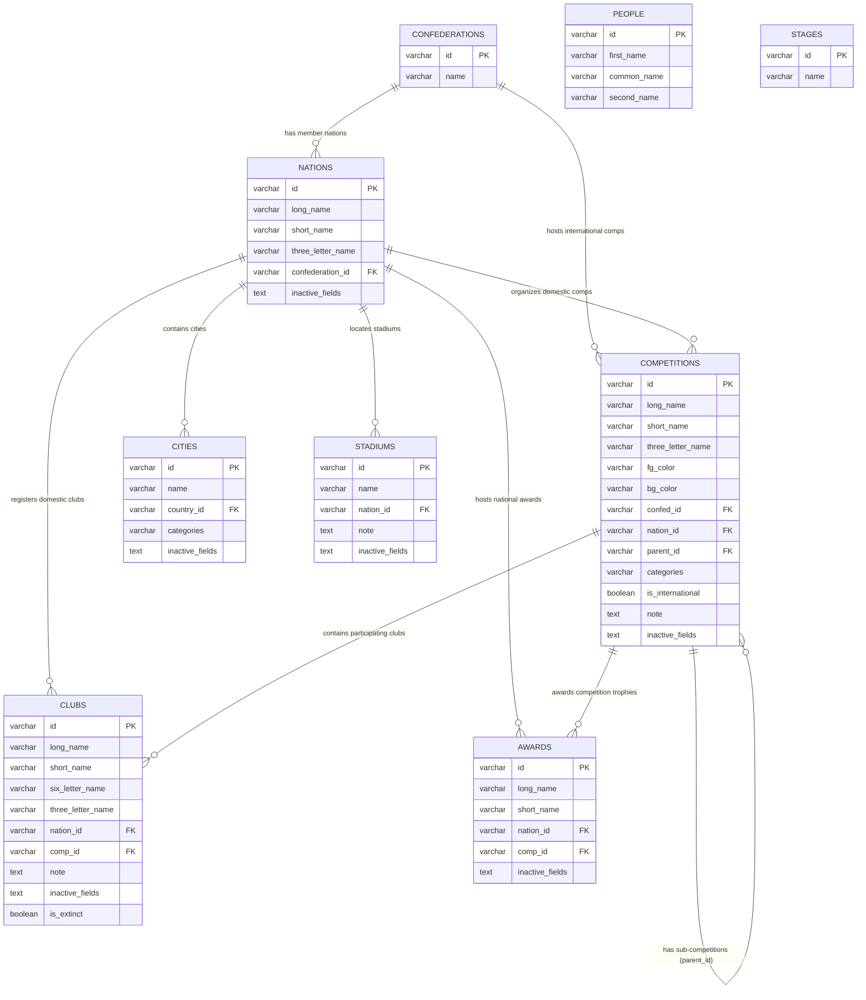

# FM LNC Manager & Explorer

> **Công cụ quản lý, khám phá và việt hóa dữ liệu file `.lnc` (Licence/Language & Name Changes) cho Football Manager 2024.**  
> Cho phép xem phân cấp đa tầng, tìm kiếm toàn văn, chỉnh sửa trực quan (CRUD) và xuất nhập dữ liệu 2 chiều cho Quốc gia, Câu lạc bộ, Giải đấu, Sân vận động, Thành phố, Giải thưởng, Nhân sự và Giai đoạn giải đấu.

---

## 📑 Mục lục Toàn diện

1. [📸 Tổng quan & Công nghệ](#-tổng-quan--công-nghệ)
2. [🗂️ Cấu trúc Dự án & Luồng Dữ liệu](#️-cấu-trúc-dự-án--luồng-dữ-liệu)
   - [2.1. Cấu trúc thư mục](#21-cấu-trúc-thư-mục)
   - [2.2. Luồng phân cấp dữ liệu (Hierarchy Flow)](#22-luồng-phân-cấp-dữ-liệu-hierarchy-flow)
3. [🚀 Hướng dẫn Cài đặt & Chạy Local](#-hướng-dẫn-cài-đặt--chạy-local)
   - [3.1. Cài đặt Backend (`fm-lnc-be`)](#31-cài-đặt-backend-fm-lnc-be)
   - [3.2. Cài đặt & Khởi động Frontend (`fm-lnc-fe`)](#32-cài-đặt--khởi-động-frontend-fm-lnc-fe)
   - [3.3. Nạp dữ liệu Seed từ file `.lnc`](#33-nạp-dữ-liệu-seed-từ-file-lnc)
4. [☁️ Hướng dẫn Deploy lên Render.com](#️-hướng-dẫn-deploy-lên-rendercom)
   - [4.1. Tạo Services trên Render](#41-tạo-services-trên-render)
   - [4.2. Import Database bằng DBeaver](#42-import-database-bằng-dbeaver)
   - [4.3. Kiểm tra kiểm thử Production](#43-kiểm-tra-kiểm-thử-production)
5. [🗄️ Thiết kế Cơ sở Dữ liệu (Database Design Specification)](#️-thiết-kế-cơ-sở-dữ-liệu-database-design-specification)
   - [5.1. Sơ đồ Quan hệ Thực thể (ERD Diagram)](#51-sơ-đồ-quan-hệ-thực-thể-erd-diagram)
   - [5.2. Đặc tả chi tiết 9 Bảng CSDL](#52-đặc-tả-chi-tiết-9-bảng-csdl)
   - [5.3. Quy tắc nghiệp vụ & Chuẩn String ID](#53-quy-tắc-nghiệp-vụ--chuẩn-string-id)
   - [5.4. Cơ chế vô hiệu hóa trường (`inactive_fields`)](#54-cơ-chế-vô-hiệu-hóa-trường-inactive_fields)
   - [5.5. Bảng ánh xạ giữa CSDL và Command `.lnc`](#55-bảng-ánh-xạ-giữa-csdl-và-command-lnc)
   - [5.6. Chiến lược Đánh chỉ mục (Indexing Strategy)](#56-chiến-lược-đánh-chỉ-mục-indexing-strategy)
   - [5.7. Full Script DDL Tạo Bảng PostgreSQL](#57-full-script-ddl-tạo-bảng-postgresql)
6. [📡 Tài liệu Danh sách API (RESTful API Reference)](#-tài-liệu-danh-sách-api-restful-api-reference)
   - [6.1. Quy tắc chung & Cấu trúc Phân cấp](#61-quy-tắc-chung--cấu-trúc-phân-cấp)
   - [6.2. Health Check API](#62-health-check-api)
   - [6.3. Hierarchy API (Cây phân cấp)](#63-hierarchy-api-cây-phân-cấp)
   - [6.4. Records API (CRUD & Chi tiết thực thể)](#64-records-api-crud--chi-tiết-thực-thể)
   - [6.5. Search API (Tìm kiếm toàn văn)](#65-search-api-tìm-kiếm-toàn-văn)
   - [6.6. LNC File API (Export & Import)](#66-lnc-file-api-export--import)
   - [6.7. Logos & Graphics API](#67-logos--graphics-api)
   - [6.8. Swagger & OpenAPI Documentation](#68-swagger--openapi-documentation)
7. [📁 GitHub Repository & Thông tin](#-github-repository--thông-tin)

---

## 📸 Tổng quan & Công nghệ

- **Frontend**: Next.js 14 (App Router) + Ant Design + Tailwind CSS + Lucide Icons
- **Backend**: NestJS 10 + TypeORM
- **Database**: PostgreSQL (>= 14) — Chuẩn định danh `VARCHAR(64)` String ID
- **API Documentation**: Swagger UI / OpenAPI 3.0
- **Data Source**: Tệp tin `.lnc` (Language / Name Change) từ Football Manager 2024
- **Logo/Graphics**: Phục vụ logo và cờ chính thức từ tệp đồ họa Football Manager 2024

---

## 🗂️ Cấu trúc Dự án & Luồng Dữ liệu

### 2.1. Cấu trúc thư mục

```
fm-lnc/
├── fm-lnc-be/              # NestJS REST API Server
│   ├── src/
│   │   ├── config/         # Cấu hình đường dẫn local (app-config.json)
│   │   ├── database/       # Startup migrations & ánh xạ quan hệ cha/con
│   │   ├── entities/       # TypeORM entities (Nation, Club, Competition, ...)
│   │   ├── hierarchy/      # API truy vấn cấu trúc phân cấp đa tầng
│   │   ├── lnc/            # Parser & export tệp .lnc
│   │   ├── logos/          # Serve logo/cờ từ filesystem Football Manager
│   │   ├── records/        # Generic CRUD records & /info endpoints
│   │   └── search/         # Tìm kiếm toàn văn 8 bảng thực thể
│   ├── scripts/
│   │   ├── seed_lnc.py     # Script nạp dữ liệu từ file .lnc vào PostgreSQL
│   │   ├── export_db.js    # Script trích xuất DB ra tệp SQL dump
│   │   └── update_club_comps.js
│   ├── Dockerfile          # Dockerfile multi-stage production
│   └── package.json
├── fm-lnc-fe/              # Next.js 14 Web Application
│   ├── src/app/
│   │   ├── page.tsx        # Dashboard điều hướng phân cấp (Châu lục, Giải quốc tế, Hub)
│   │   ├── comp/           # Giao diện quản lý Giải đấu & Danh sách CLB
│   │   ├── nation/         # Giao diện Hub Quốc gia & các danh mục trực thuộc
│   │   └── confederation/  # Giao diện Liên đoàn châu lục
│   ├── src/components/     # UI Components (Header, Sidebar, EntityCard, Modals, Drawers)
│   ├── src/services/api.ts # API client kết nối Backend Cloud & Local
│   └── package.json
├── render.yaml             # Cấu hình Blueprint tự động triển khai Render.com
├── AGENTS.md               # Quy định làm việc dành cho AI / Agent
└── README.md               # Tài liệu tổng hợp toàn diện dự án
```

### 2.2. Luồng phân cấp dữ liệu (Hierarchy Flow)

Hệ thống được thiết kế theo cấu trúc tổ chức thực tế của thế giới bóng đá và Football Manager:

```
[Confederation / World] (Châu lục / Toàn cầu)
   │
   ├──> [International Competitions] (Giải quốc tế: UCL, World Cup, Copa Libertadores, v.v.)
   │        ├──> [Clubs] (CLB tham gia giải quốc tế)
   │        └──> [Awards] (Giải thưởng thuộc giải quốc tế)
   │
   └──> [Nations] (Quốc gia thành viên)
            ├──> [Domestic Competitions] (Giải quốc nội cấp cha: Premier League, V-League 1)
            │        ├──> [Sub-Competitions] (Giải con / vòng bảng: parent_id = comp_id)
            │        ├──> [Clubs] (CLB trực thuộc giải đấu)
            │        └──> [Awards] (Giải thưởng trực thuộc giải đấu)
            ├──> [Independent Clubs] (CLB tự do, phong trào không gắn giải cố định: comp_id = NULL)
            ├──> [Extinct Clubs] (CLB đã giải thể: is_extinct = true)
            ├──> [Stadiums] (Sân vận động thuộc quốc gia)
            ├──> [Cities] (Thành phố thuộc quốc gia)
            └──> [Independent Awards] (Giải thưởng độc lập cấp quốc gia)

[Global Directory] (Danh mục thực thể dùng chung toàn cầu)
   ├──> [People] (Cầu thủ, Huấn luyện viên, Trọng tài, Giám đốc)
   └──> [Stages] (Tên gọi các vòng đấu / giai đoạn thi đấu)
```

---

## 🚀 Hướng dẫn Cài đặt & Chạy Local

### Yêu cầu môi trường
- **Node.js**: >= 20.x
- **PostgreSQL**: >= 14.x
- **Python**: >= 3.9 (để chạy script nạp dữ liệu ban đầu)
- **Football Manager 2024**: (Tùy chọn, để phục vụ ảnh logo và đọc file `.lnc` local)

---

### 3.1. Cài đặt Backend (`fm-lnc-be`)

1. Di chuyển vào thư mục backend và cài đặt thư viện:
   ```bash
   cd fm-lnc-be
   npm install
   ```

2. Tạo tệp `.env` trong `fm-lnc-be/`:
   ```env
   PORT=3001
   HOST=0.0.0.0
   DB_HOST=127.0.0.1
   DB_PORT=5432
   DB_USERNAME=postgres
   DB_PASSWORD=your_password
   DB_NAME=fm_lnc_db
   LNC_FILES_DIR=../../
   ```

3. Cấu hình đường dẫn dữ liệu Football Manager local trong `fm-lnc-be/app-config.json`:
   ```json
   {
     "lncDir": "D:\\Games\\FM24_2026\\FootballManager24\\data\\database\\db\\2430\\lnc\\all",
     "confedLogoDir": "D:\\Games\\Documents\\Sports Interactive\\Football Manager 2024\\graphics\\logo\\Confederations\\normal",
     "nationLogoDir": "D:\\Games\\Documents\\Sports Interactive\\Football Manager 2024\\graphics\\logo\\Nations\\normal",
     "compLogoDir": "D:\\Games\\Documents\\Sports Interactive\\Football Manager 2024\\graphics\\logo\\Competitions",
     "clubLogoDir": "D:\\Games\\Documents\\Sports Interactive\\Football Manager 2024\\graphics\\logo\\Club"
   }
   ```

4. Khởi động Backend:
   ```bash
   npm run start:dev   # Môi trường phát triển (watch mode)
   # Hoặc build production:
   npm run build
   npm run start:prod
   ```
   > 📡 Backend chạy tại: `http://localhost:3001`  
   > 📖 Swagger UI: `http://localhost:3001/docs`

---

### 3.2. Cài đặt & Khởi động Frontend (`fm-lnc-fe`)

1. Di chuyển vào thư mục frontend và cài đặt dependencies:
   ```bash
   cd fm-lnc-fe
   npm install
   ```

2. Tạo tệp `.env.local` trong `fm-lnc-fe/`:
   ```env
   # API Backend Production trên Render (hoặc trỏ tới local nếu chạy offline)
   NEXT_PUBLIC_API_URL=https://fm-lnc-backend.onrender.com/api

   # API Backend Localhost (phục vụ đọc logo, ảnh & tệp lnc trực tiếp từ máy)
   NEXT_PUBLIC_LOCAL_API_URL=http://127.0.0.1:3001/api
   ```

3. Khởi động Frontend:
   ```bash
   npm run dev
   ```
   > 🌐 Mở trình duyệt: `http://localhost:3000`

---

### 3.3. Nạp dữ liệu Seed từ file `.lnc`

1. Cài đặt thư viện Python kết nối PostgreSQL:
   ```bash
   pip install psycopg2-binary
   ```

2. Chạy script seed tự động phân tích và nạp ~28,000 bản ghi:
   ```bash
   cd fm-lnc-be
   npm run seed
   ```

---

## ☁️ Hướng dẫn Deploy lên Render.com

Dự án đã tích hợp sẵn Blueprint [`render.yaml`](./render.yaml) để triển khai tự động gồm **Web Service (NestJS Backend)** và **PostgreSQL Database**.

### 4.1. Tạo Services trên Render
1. Đăng nhập vào [Render Dashboard](https://render.com) &rarr; **New** &rarr; **Blueprint**.
2. Kết nối tới GitHub repository: `https://github.com/ddthumonky88/fm-lnc`.
3. Render tự động nhận diện `render.yaml` và khởi tạo:
   - Web Service: `fm-lnc-backend` (Docker runtime)
   - Managed PostgreSQL: `fm-lnc-db`
4. Đợi Database khởi tạo xong, truy cập tab **Info** của Database &rarr; copy **External Database URL**.

### 4.2. Import Database bằng DBeaver
1. Mở phần mềm **DBeaver** &rarr; chọn **New Database Connection** &rarr; **PostgreSQL**.
2. Chuyển sang tab **URL** &rarr; paste chuỗi **External Database URL** lấy từ Render.
3. Nhấn **Test Connection** &rarr; nhấn **Finish**.
4. Trong cây điều hướng DBeaver, chuột phải vào database `fm_lnc_db` &rarr; chọn **Tools** &rarr; **Execute Script**.
5. Chọn tệp SQL dump tại `fm-lnc-be/scripts/db_dump_full.sql` &rarr; nhấn **Start**.
6. Chờ ~30 giây để hoàn tất nạp toàn bộ cấu trúc bảng và ~28,000 bản ghi.

### 4.3. Kiểm tra kiểm thử Production
Kiểm tra endpoint sức khỏe:
```bash
curl https://fm-lnc-backend.onrender.com/health
```
Kết quả trả về: `{"status":"ok","timestamp":"..."}`.

> 💡 **Lưu ý triển khai Cloud:** Tính năng duyệt logo đồ họa và import/export tệp `.lnc` trực tiếp từ ổ cứng yêu cầu môi trường local có cài đặt game FM2024. Trên Cloud Render, backend hoạt động độc lập phục vụ toàn bộ dữ liệu từ PostgreSQL.

---

## 🗄️ Thiết kế Cơ sở Dữ liệu (Database Design Specification)

- **Hệ quản trị CSDL:** PostgreSQL (>= 14)
- **Framework ORM:** TypeORM (NestJS)
- **Quy ước khóa chính/ngoại:** Chuỗi ký tự (`VARCHAR(64)` / `string`) cho toàn bộ Primary Key và Foreign Key.

---

### 5.1. Sơ đồ Quan hệ Thực thể (ERD Diagram)



---

### 5.2. Đặc tả chi tiết 9 Bảng CSDL

#### 1. Bảng `confederations` (Châu lục / Liên đoàn)
| Tên cột | Kiểu dữ liệu | Khóa | Nullable | Ý nghĩa & Ghi chú |
| :--- | :--- | :---: | :---: | :--- |
| `id` | `VARCHAR(64)` | **PK** | No | Unique Game ID của Châu lục / Liên đoàn (e.g. `'1'`, `'2'`, `'7'`) |
| `name` | `VARCHAR(255)` | | No | Tên liên đoàn (e.g. `Europe`, `Asia`, `World`) |

#### 2. Bảng `nations` (Quốc gia)
| Tên cột | Kiểu dữ liệu | Khóa | Nullable | Ý nghĩa & Ghi chú |
| :--- | :--- | :---: | :---: | :--- |
| `id` | `VARCHAR(64)` | **PK** | No | Unique Game ID của Quốc gia trong Football Manager |
| `long_name` | `VARCHAR(255)` | | No | Tên quốc gia đầy đủ (e.g. `Vietnam`, `England`) |
| `short_name` | `VARCHAR(255)` | | No | Tên rút gọn (e.g. `Vietnam`, `England`) |
| `three_letter_name` | `VARCHAR(50)` | | No | Mã 3 ký tự (e.g. `VIE`, `ENG`, `FRA`) |
| `confederation_id` | `VARCHAR(64)` | **FK** | Yes | Tham chiếu tới `confederations.id` (ON DELETE SET NULL) |
| `inactive_fields` | `TEXT` | | Yes | Danh sách trường bị comment `#` khi xuất file `.lnc` |

#### 3. Bảng `competitions` (Giải đấu & Phân hạng)
| Tên cột | Kiểu dữ liệu | Khóa | Nullable | Ý nghĩa & Ghi chú |
| :--- | :--- | :---: | :---: | :--- |
| `id` | `VARCHAR(64)` | **PK** | No | Unique Game ID của giải đấu |
| `long_name` | `VARCHAR(255)` | | No | Tên giải đấu đầy đủ (e.g. `English Premier Division`) |
| `short_name` | `VARCHAR(255)` | | No | Tên rút gọn giải đấu (e.g. `Premier League`) |
| `three_letter_name` | `VARCHAR(50)` | | Yes | Mã 3 ký tự (e.g. `PL`, `EPL`) |
| `fg_color` | `VARCHAR(100)` | | Yes | Mã màu chữ RGB (e.g. `255 255 255`) |
| `bg_color` | `VARCHAR(100)` | | Yes | Mã màu nền RGB (e.g. `59 89 152`) |
| `confed_id` | `VARCHAR(64)` | **FK** | Yes | Tham chiếu `confederations.id` (nếu là giải quốc tế) |
| `nation_id` | `VARCHAR(64)` | **FK** | Yes | Tham chiếu `nations.id` (nếu là giải quốc nội) |
| `parent_id` | `VARCHAR(64)` | **FK** | Yes | Tham chiếu giải đấu cấp cha (nếu là giải đấu con/vòng bảng) |
| `categories` | `VARCHAR(255)` | | Yes | Phân cấp giải: `First Tier`, `Domestic Cup`, `Super Cup`, v.v. |
| `is_international` | `BOOLEAN` | | No | Đánh dấu giải quốc tế (`true`) hoặc giải quốc nội (`false`) |
| `note` | `TEXT` | | Yes | Ghi chú nội bộ |
| `inactive_fields` | `TEXT` | | Yes | Các trường bị comment out khi xuất `.lnc` |

#### 4. Bảng `clubs` (Câu lạc bộ)
| Tên cột | Kiểu dữ liệu | Khóa | Nullable | Ý nghĩa & Ghi chú |
| :--- | :--- | :---: | :---: | :--- |
| `id` | `VARCHAR(64)` | **PK** | No | Unique Game ID của Câu lạc bộ |
| `long_name` | `VARCHAR(255)` | | No | Tên CLB đầy đủ (e.g. `Arsenal Football Club`) |
| `short_name` | `VARCHAR(255)` | | No | Tên CLB rút gọn (e.g. `Arsenal`) |
| `six_letter_name` | `VARCHAR(50)` | | Yes | Tên 6 ký tự hiển thị bảng tỉ số (e.g. `ARSENL`) |
| `three_letter_name` | `VARCHAR(50)` | | Yes | Mã 3 ký tự (e.g. `ARS`) |
| `nation_id` | `VARCHAR(64)` | **FK** | Yes | Tham chiếu `nations.id` |
| `comp_id` | `VARCHAR(64)` | **FK** | Yes | Tham chiếu `competitions.id` (NULL nếu là CLB độc lập) |
| `note` | `TEXT` | | Yes | Ghi chú CLB |
| `inactive_fields` | `TEXT` | | Yes | Các trường bị comment out khi xuất `.lnc` |
| `is_extinct` | `BOOLEAN` | | No | Đánh dấu CLB đã giải thể (`true`) |

#### 5. Bảng `cities` (Thành phố)
| Tên cột | Kiểu dữ liệu | Khóa | Nullable | Ý nghĩa & Ghi chú |
| :--- | :--- | :---: | :---: | :--- |
| `id` | `VARCHAR(64)` | **PK** | No | Unique Game ID của Thành phố |
| `name` | `VARCHAR(255)` | | No | Tên thành phố (e.g. `Hà Nội`, `London`) |
| `country_id` | `VARCHAR(64)` | **FK** | Yes | Tham chiếu `nations.id` |
| `categories` | `VARCHAR(255)` | | Yes | Phân vùng miền / bang / khu vực |
| `inactive_fields` | `TEXT` | | Yes | Danh sách trường comment out |

#### 6. Bảng `stadiums` (Sân vận động)
| Tên cột | Kiểu dữ liệu | Khóa | Nullable | Ý nghĩa & Ghi chú |
| :--- | :--- | :---: | :---: | :--- |
| `id` | `VARCHAR(64)` | **PK** | No | Unique Game ID của Sân vận động |
| `name` | `VARCHAR(255)` | | No | Tên sân vận động (e.g. `Sân vận động Quốc gia Mỹ Đình`) |
| `nation_id` | `VARCHAR(64)` | **FK** | Yes | Tham chiếu `nations.id` |
| `note` | `TEXT` | | Yes | Ghi chú sân vận động |
| `inactive_fields` | `TEXT` | | Yes | Danh sách trường comment out |

#### 7. Bảng `awards` (Danh hiệu & Giải thưởng)
| Tên cột | Kiểu dữ liệu | Khóa | Nullable | Ý nghĩa & Ghi chú |
| :--- | :--- | :---: | :---: | :--- |
| `id` | `VARCHAR(64)` | **PK** | No | Unique Game ID của Giải thưởng |
| `long_name` | `VARCHAR(255)` | | No | Tên giải thưởng đầy đủ (e.g. `Player of the Season`) |
| `short_name` | `VARCHAR(255)` | | No | Tên giải thưởng rút gọn |
| `nation_id` | `VARCHAR(64)` | **FK** | Yes | Tham chiếu `nations.id` (nếu là giải thưởng quốc gia) |
| `comp_id` | `VARCHAR(64)` | **FK** | Yes | Tham chiếu `competitions.id` (nếu gắn giải đấu) |
| `inactive_fields` | `TEXT` | | Yes | Danh sách trường comment out |

#### 8. Bảng `people` (Cầu thủ & Ban huấn luyện)
| Tên cột | Kiểu dữ liệu | Khóa | Nullable | Ý nghĩa & Ghi chú |
| :--- | :--- | :---: | :---: | :--- |
| `id` | `VARCHAR(64)` | **PK** | No | Unique Game ID của Nhân vật |
| `first_name` | `VARCHAR(255)` | | No | Tên trước (First name) |
| `common_name` | `VARCHAR(255)` | | No | Tên thường gọi / Biệt danh (e.g. `Pelé`, `Kaka`) |
| `second_name` | `VARCHAR(255)` | | No | Họ / Tên sau (Surname) |

#### 9. Bảng `stages` (Giai đoạn & Vòng đấu)
| Tên cột | Kiểu dữ liệu | Khóa | Nullable | Ý nghĩa & Ghi chú |
| :--- | :--- | :---: | :---: | :--- |
| `id` | `VARCHAR(64)` | **PK** | No | Unique Game ID của Vòng đấu |
| `name` | `VARCHAR(255)` | | No | Tên giai đoạn (e.g. `Vòng loại thứ 3`, `Chung kết`) |

---

### 5.3. Quy tắc nghiệp vụ & Chuẩn String ID
1. **Tránh lỗi tràn số nguyên:** Trong JavaScript / V8 engine, số nguyên vượt quá `Number.MAX_SAFE_INTEGER` ($2^{53} - 1 = 9,007,199,254,740,991$) sẽ bị làm tròn sai lệch chữ số cuối. Việc lưu trữ `VARCHAR(64)` / `string` đảm bảo Game ID luôn chính xác tuyệt đối.
2. **Đồng nhất đa tầng:** JSON API, TypeORM, Next.js State và LNC Parser vận hành trên cùng kiểu chuỗi, loại bỏ hoàn toàn chi phí ép kiểu và các lỗi tiềm ẩn.

---

### 5.4. Cơ chế vô hiệu hóa trường (`inactive_fields`)
Người dùng có thể tạm ngưng đồng bộ một trường dữ liệu (ví dụ: giữ nguyên màu sắc mặc định của game, chỉ đổi tên). Khi xuất file `.lnc`, backend tự động thêm ký tự comment `#` ở đầu các dòng lệnh tương ứng với trường có tên trong `inactive_fields`.

---

### 5.5. Bảng ánh xạ giữa CSDL và Command `.lnc`

| Bảng CSDL | Trường dữ liệu | Command tương ứng trong file `.lnc` | Cú pháp xuất file |
| :--- | :--- | :--- | :--- |
| `nations` | `long_name` | `"NATION_LONG_NAME_CHANGE"` | `"NATION_LONG_NAME_CHANGE" <id> "<long_name>" 8` |
| `nations` | `short_name` | `"NATION_SHORT_NAME_CHANGE"` | `"NATION_SHORT_NAME_CHANGE" <id> "<short_name>" 8` |
| `nations` | `three_letter_name` | `"NATION_3LETTER_NAME_CHANGE"` | `"NATION_3LETTER_NAME_CHANGE" <id> "<three_letter_name>" 8` |
| `competitions` | `long_name` | `"COMP_LONG_NAME_CHANGE"` | `"COMP_LONG_NAME_CHANGE" <id> "<long_name>" ""` |
| `competitions` | `short_name` | `"COMP_SHORT_NAME_CHANGE"` | `"COMP_SHORT_NAME_CHANGE" <id> "<short_name>" ""` |
| `competitions` | `three_letter_name` | `"COMP_3LETTER_NAME_CHANGE"` | `"COMP_3LETTER_NAME_CHANGE" <id> "<three_letter_name>" ""` |
| `competitions` | `fg_color`, `bg_color` | `"COMP_COLOUR_CHANGE"` | `"COMP_COLOUR_CHANGE" <id> 0 <fg_color> <bg_color> ""` |
| `clubs` | `long_name` | `"CLUB_LONG_NAME_CHANGE"` | `"CLUB_LONG_NAME_CHANGE" <id> "<long_name>" ""` |
| `clubs` | `short_name` | `"CLUB_SHORT_NAME_CHANGE"` | `"CLUB_SHORT_NAME_CHANGE" <id> "<short_name>" ""` |
| `clubs` | `six_letter_name` | `"CLUB_6LETTER_NAME_CHANGE"` | `"CLUB_6LETTER_NAME_CHANGE" <id> "<six_letter_name>" ""` |
| `clubs` | `three_letter_name` | `"CLUB_3LETTER_NAME_CHANGE"` | `"CLUB_3LETTER_NAME_CHANGE" <id> "<three_letter_name>" ""` |
| `cities` | `name` | `"CITY_NAME_CHANGE"` | `"CITY_NAME_CHANGE" <id> "<name>" ""` |
| `stadiums` | `name` | `"STADIUM_NAME_CHANGE"` | `"STADIUM_NAME_CHANGE" <id> "<name>" ""` |
| `awards` | `long_name` | `"AWARD_LONG_NAME_CHANGE"` | `"AWARD_LONG_NAME_CHANGE" <id> "<long_name>" ""` |
| `awards` | `short_name` | `"AWARD_SHORT_NAME_CHANGE"` | `"AWARD_SHORT_NAME_CHANGE" <id> "<short_name>" ""` |
| `people` | `first_name`, `common_name`, `second_name` | `"CHANGE_PLAYER_NAME"` | `"CHANGE_PLAYER_NAME" <id> "<first_name>" "<common_name>" "<second_name>"` |
| `stages` | `name` | `"STAGE_NAME_CHANGE"` | `"STAGE_NAME_CHANGE" <id> "<name>"` |

---

### 5.6. Chiến lược Đánh chỉ mục (Indexing Strategy)

```sql
-- 1. Cây phân cấp Quốc gia & Châu lục
CREATE INDEX IF NOT EXISTS idx_nations_confed ON nations(confederation_id);
CREATE INDEX IF NOT EXISTS idx_comps_confed ON competitions(confed_id);
CREATE INDEX IF NOT EXISTS idx_comps_nation ON competitions(nation_id);
CREATE INDEX IF NOT EXISTS idx_comps_parent ON competitions(parent_id);
CREATE INDEX IF NOT EXISTS idx_comps_is_inter ON competitions(is_international);

-- 2. Phân nhóm Câu lạc bộ
CREATE INDEX IF NOT EXISTS idx_clubs_comp ON clubs(comp_id);
CREATE INDEX IF NOT EXISTS idx_clubs_nation ON clubs(nation_id);
CREATE INDEX IF NOT EXISTS idx_clubs_is_extinct ON clubs(is_extinct);

-- 3. Thực thể trực thuộc Quốc gia
CREATE INDEX IF NOT EXISTS idx_cities_country ON cities(country_id);
CREATE INDEX IF NOT EXISTS idx_stadiums_nation ON stadiums(nation_id);
CREATE INDEX IF NOT EXISTS idx_awards_nation ON awards(nation_id);
CREATE INDEX IF NOT EXISTS idx_awards_comp ON awards(comp_id);

-- 4. Tối ưu tìm kiếm văn bản
CREATE INDEX IF NOT EXISTS idx_clubs_short_name ON clubs(short_name);
CREATE INDEX IF NOT EXISTS idx_comps_short_name ON competitions(short_name);
CREATE INDEX IF NOT EXISTS idx_people_second_name ON people(second_name);
```

---

### 5.7. Full Script DDL Tạo Bảng PostgreSQL

```sql
-- ====================================================================
-- FM .LNC MANAGER - POSTGRESQL FULL SCHEMA DDL (STRING ID VERSION)
-- ====================================================================

CREATE TABLE IF NOT EXISTS confederations (
    id VARCHAR(64) PRIMARY KEY,
    name VARCHAR(255) NOT NULL
);

CREATE TABLE IF NOT EXISTS nations (
    id VARCHAR(64) PRIMARY KEY,
    long_name VARCHAR(255) NOT NULL,
    short_name VARCHAR(255) NOT NULL,
    three_letter_name VARCHAR(50) NOT NULL,
    confederation_id VARCHAR(64) REFERENCES confederations(id) ON DELETE SET NULL,
    inactive_fields TEXT
);

CREATE TABLE IF NOT EXISTS competitions (
    id VARCHAR(64) PRIMARY KEY,
    long_name VARCHAR(255) NOT NULL,
    short_name VARCHAR(255) NOT NULL,
    three_letter_name VARCHAR(50),
    fg_color VARCHAR(100),
    bg_color VARCHAR(100),
    confed_id VARCHAR(64) REFERENCES confederations(id) ON DELETE SET NULL,
    nation_id VARCHAR(64) REFERENCES nations(id) ON DELETE SET NULL,
    parent_id VARCHAR(64) REFERENCES competitions(id) ON DELETE SET NULL,
    categories VARCHAR(255),
    is_international BOOLEAN DEFAULT FALSE,
    note TEXT,
    inactive_fields TEXT
);

CREATE TABLE IF NOT EXISTS clubs (
    id VARCHAR(64) PRIMARY KEY,
    long_name VARCHAR(255) NOT NULL,
    short_name VARCHAR(255) NOT NULL,
    six_letter_name VARCHAR(50),
    three_letter_name VARCHAR(50),
    nation_id VARCHAR(64) REFERENCES nations(id) ON DELETE SET NULL,
    comp_id VARCHAR(64) REFERENCES competitions(id) ON DELETE SET NULL,
    note TEXT,
    inactive_fields TEXT,
    is_extinct BOOLEAN DEFAULT FALSE
);

CREATE TABLE IF NOT EXISTS cities (
    id VARCHAR(64) PRIMARY KEY,
    name VARCHAR(255) NOT NULL,
    country_id VARCHAR(64) REFERENCES nations(id) ON DELETE SET NULL,
    categories VARCHAR(255),
    inactive_fields TEXT
);

CREATE TABLE IF NOT EXISTS stadiums (
    id VARCHAR(64) PRIMARY KEY,
    name VARCHAR(255) NOT NULL,
    nation_id VARCHAR(64) REFERENCES nations(id) ON DELETE SET NULL,
    note TEXT,
    inactive_fields TEXT
);

CREATE TABLE IF NOT EXISTS awards (
    id VARCHAR(64) PRIMARY KEY,
    long_name VARCHAR(255) NOT NULL,
    short_name VARCHAR(255) NOT NULL,
    nation_id VARCHAR(64) REFERENCES nations(id) ON DELETE SET NULL,
    comp_id VARCHAR(64) REFERENCES competitions(id) ON DELETE SET NULL,
    inactive_fields TEXT
);

CREATE TABLE IF NOT EXISTS people (
    id VARCHAR(64) PRIMARY KEY,
    first_name VARCHAR(255) NOT NULL,
    common_name VARCHAR(255) DEFAULT '',
    second_name VARCHAR(255) NOT NULL
);

CREATE TABLE IF NOT EXISTS stages (
    id VARCHAR(64) PRIMARY KEY,
    name VARCHAR(255) NOT NULL
);
```

---

## 📡 Tài liệu Danh sách API (RESTful API Reference)

- **Base URL mặc định (Local)**: `http://localhost:3001`
- **Base URL (Production)**: `https://fm-lnc-backend.onrender.com`
- **Swagger Documentation**: `http://localhost:3001/docs`

---

### 6.1. Quy tắc chung & Cấu trúc Phân cấp

1. Toàn bộ API tuân theo chuẩn RESTful JSON. Mọi Game ID (`id`, `confederation_id`, `nation_id`, `comp_id`,...) đều có kiểu dữ liệu là chuỗi (`string`).
2. **Quy tắc phân cấp giải đấu:**
   - `GET /api/hierarchy/nations/:id/competitions`: **Chỉ trả về các giải đấu quốc nội cấp cha (`parent_id IS NULL`)** của quốc gia đó.
   - `GET /api/hierarchy/competitions/:id/sub-competitions`: **Trả về danh sách giải đấu con / phân hạng trực thuộc giải đấu cha `{id}` (`parent_id = :id`)**.
3. **API Chi tiết quan hệ (`/info`):** Cung cấp dữ liệu đầy đủ kèm thực thể cha/con và bộ đếm thống kê cho 7 thực thể chính (`confederation`, `nation`, `competition`, `club`, `city`, `award`, `stadium`).

---

### 6.2. Health Check API

#### `GET /health`
Kiểm tra tình trạng hoạt động của NestJS Backend Server.
- **Method**: `GET`
- **Phản hồi (`200 OK`)**:
  ```json
  {
    "status": "ok",
    "timestamp": "2026-10-24T15:00:00.000Z"
  }
  ```

---

### 6.3. Hierarchy API (Cây phân cấp)

Prefix: `/api/hierarchy`

#### 1. Confederations (Châu lục / Liên đoàn)
- **`GET /api/hierarchy/continents`**
  - Lấy danh sách 7 liên đoàn kèm số lượng quốc gia (`totalNations`) và giải đấu quốc tế (`totalIntComps`).
- **`GET /api/hierarchy/continents/:id/info`**
  - Thông tin chi tiết một liên đoàn kèm bộ đếm tổng thể (`totalNations`, `totalIntComps`, `totalComps`, `totalClubs`, `totalStadiums`, `totalCities`, `totalAwards`).

#### 2. Nations (Quốc gia)
- **`GET /api/hierarchy/continents/:id/nations`**
  - Lấy danh sách quốc gia thuộc một liên đoàn kèm các bộ đếm số lượng thực thể con.
- **`GET /api/hierarchy/nations`**
  - Danh sách toàn bộ quốc gia trong hệ thống.
  - Query params: `confedId` *(lọc theo liên đoàn)*, `q` *(tìm kiếm tên hoặc mã ID)*.
- **`GET /api/hierarchy/nations/:id/info`**
  - Chi tiết quốc gia kèm đối tượng liên đoàn cha và thống kê chi tiết (`domesticComps`, `parentComps`, `independentClubs`, `extinctClubs`, `allClubs`, `stadiums`, `cities`, `awards`).
- **`GET /api/hierarchy/nations/:id/hub`**
  - Tổng quan giao diện Hub của một quốc gia.

#### 3. Competitions (Giải đấu)
- **`GET /api/hierarchy/continents/:id/international-competitions`**
  - Danh sách giải đấu quốc tế cấp cha (`parent_id IS NULL`) của liên đoàn (e.g. Champions League, Euro, World Cup).
- **`GET /api/hierarchy/nations/:id/competitions`**
  - Danh sách giải đấu quốc nội cấp cha (`parent_id IS NULL`) của quốc gia đó.
  - Tự động bổ sung 2 danh mục ảo: `[OTHER]` (CLB tự do) và `[EXTINCT]` (CLB giải thể).
- **`GET /api/hierarchy/competitions/:id/sub-competitions`**
  - Danh sách các giải đấu con / phân hạng trực thuộc giải đấu cha `{id}` (`parent_id = :id`).
- **`GET /api/hierarchy/competitions/:id/info`**
  - Thông tin chi tiết giải đấu, màu sắc RGB, số lượng CLB (`clubsCount`), giải thưởng (`awardsCount`), giải đấu con (`childrenCount`), thông tin giải cha và quốc gia liên kết.
- **`GET /api/hierarchy/competitions`**
  - Tìm kiếm và lọc giải đấu đa chiều (`confedId`, `nationId`, `isInternational`, `q`).
- **`GET /api/hierarchy/competitions/:id/clubs`**
  - Danh sách các câu lạc bộ thi đấu tại giải đấu `{id}`.
- **`GET /api/hierarchy/competitions/:id/awards`**
  - Danh sách giải thưởng thuộc về giải đấu `{id}`.

#### 4. Clubs (Câu lạc bộ)
- **`GET /api/hierarchy/clubs/:id/info`**
  - Thông tin chi tiết CLB kèm quốc gia (`nation`), giải đấu trực thuộc (`competition`) và giải đấu cha.
- **`GET /api/hierarchy/nations/:id/independent-clubs`**
  - Danh sách CLB độc lập/tự do của quốc gia. Query param: `extinct=true` để lấy CLB đã giải thể.
- **`GET /api/hierarchy/nations/:id/all-clubs`**
  - Lấy tất cả câu lạc bộ thuộc quốc gia.

#### 5. Sân vận động, Thành phố, Giải thưởng, Nhân sự & Giai đoạn
- **`GET /api/hierarchy/cities/:id/info`** & **`GET /api/hierarchy/nations/:id/cities`**
  - Thông tin chi tiết và danh sách thành phố thuộc quốc gia.
- **`GET /api/hierarchy/stadiums/:id/info`** & **`GET /api/hierarchy/nations/:id/stadiums`**
  - Thông tin chi tiết và danh sách sân vận động thuộc quốc gia.
- **`GET /api/hierarchy/awards/:id/info`** & **`GET /api/hierarchy/nations/:id/awards`** & **`GET /api/hierarchy/awards`**
  - Quản lý danh hiệu / giải thưởng độc lập hoặc gắn với giải đấu.
- **`GET /api/hierarchy/players`**
  - Danh sách cầu thủ, HLV, nhân sự (Query param: `q`).
- **`GET /api/hierarchy/stages`**
  - Danh sách tên các giai đoạn / vòng thi đấu (Query param: `q`).

---

### 6.4. Records API (CRUD & Chi tiết thực thể)

Prefix: `/api/records`  
Hỗ trợ các loại thực thể (`:type`): `confederation`, `nation`, `competition`, `club`, `stadium`, `city`, `award`, `person`, `stage`.

#### 1. Chi tiết thực thể đầy đủ quan hệ
- **`GET /api/records/:type/:id/info`**
  - Trả về đối tượng info chi tiết kèm thực thể cha/con và bộ đếm thống kê tương ứng.

#### 2. Chi tiết bản ghi cơ bản (Raw Record)
- **`GET /api/records/:type/:id`**
  - Lấy dữ liệu phẳng từ bảng cơ sở dữ liệu.

#### 3. Tạo mới bản ghi
- **`POST /api/records/:type`**
  - Body mẫu (JSON):
    ```json
    {
      "id": "990001",
      "long_name": "Hanoi Police FC",
      "short_name": "CAHN",
      "three_letter_name": "CAH",
      "nation_id": "560",
      "comp_id": "1301389"
    }
    ```
  - *(Trường `id` là bắt buộc).*

#### 4. Cập nhật bản ghi
- **`PUT /api/records/:type/:id`**
  - Body mẫu (JSON):
    ```json
    {
      "long_name": "Manchester United Football Club",
      "short_name": "Man Utd",
      "note": "Updated via LNC Manager"
    }
    ```

#### 5. Xóa bản ghi
- **`DELETE /api/records/:type/:id`**
  - Xóa bản ghi khỏi cơ sở dữ liệu.

---

### 6.5. Search API (Tìm kiếm toàn văn)

#### `GET /api/search`
Tìm kiếm toàn văn đồng thời trên 8 bảng dữ liệu: Clubs, Competitions, Nations, Stadiums, Cities, Awards, Players, Stages. Hỗ trợ tìm kiếm theo chuỗi ký tự (case-insensitive) hoặc chính xác theo số ID.

- **Query Parameters**:
  - `q` *(string, required)*: Từ khóa tìm kiếm hoặc ID.
  - `limit` *(number, optional, mặc định: 20)*: Số lượng kết quả tối đa cho từng nhóm thực thể.
- **Phản hồi mẫu (`200 OK`)**:
  ```json
  {
    "clubs": [
      {
        "id": "676",
        "long_name": "Liverpool Football Club",
        "short_name": "Liverpool",
        "nation": { "id": "11", "long_name": "England" }
      }
    ],
    "competitions": [],
    "nations": [],
    "stadiums": [],
    "cities": [],
    "awards": [],
    "players": [],
    "stages": []
  }
  ```

---

### 6.6. LNC File API (Export & Import)

Prefix: `/api/lnc`

#### 1. Export file `.lnc` chuẩn Football Manager
- **`GET /api/lnc/export`**
  - Đọc toàn bộ cơ sở dữ liệu và tổng hợp thành nội dung tệp `.lnc` hợp lệ của Football Manager 2024.
  - Query param: `download=true` để kích hoạt tải file trực tiếp về trình duyệt (`FM24_Merged_Names.lnc`).

#### 2. Import file `.lnc` vào PostgreSQL
- **`POST /api/lnc/import`**
  - Đọc các tệp `.lnc` từ thư mục local trên máy chủ và cập nhật vào PostgreSQL.
  - Request Body (tùy chọn):
    ```json
    {
      "dir": "D:/Games/FM24_2026/FootballManager24/data/database/db/2430/lnc/all"
    }
    ```

#### 3. Thống kê số lượng bản ghi DB
- **`GET /api/lnc/status`**
  - Trả về số lượng bản ghi hiện có của 9 bảng dữ liệu trong PostgreSQL.

---

### 6.7. Logos & Graphics API

Prefix: `/api/logos`  
Serve tệp hình ảnh logo định dạng `.png` trực tiếp từ bộ cài game Football Manager local (kèm header cache trình duyệt 7 ngày).

- **`GET /api/logos/confederation/:id`**: Trả về ảnh logo của Confederation.
- **`GET /api/logos/nation/:id?code=VIE`**: Trả về ảnh cờ/logo của Nation.

---

### 6.8. Swagger & OpenAPI Documentation

Hệ thống cung cấp Swagger UI trực quan để tra cứu và thử nghiệm trực tiếp các API trên trình duyệt:
- **Swagger Documentation UI**: `http://localhost:3001/docs` hoặc `http://localhost:3001/api/docs`
- **OpenAPI JSON Spec**: `http://localhost:3001/docs-json`

---

## 📁 GitHub Repository & Thông tin

- **GitHub Repository**: [https://github.com/ddthumonky88/fm-lnc](https://github.com/ddthumonky88/fm-lnc)
- **Quy định Commit & Push**: Tuân thủ hướng dẫn trong [`AGENTS.md`](./AGENTS.md).
