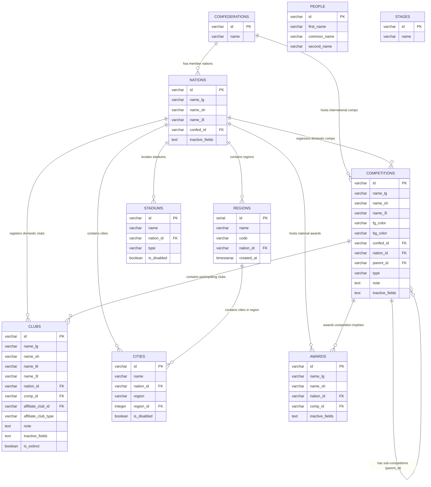

# FM LNC Manager & Explorer

> **Công cụ quản lý, khám phá và việt hóa dữ liệu file `.lnc` (Licence/Language & Name Changes) cho Football Manager 2024.**  
> Cho phép xem phân cấp đa tầng, tìm kiếm toàn văn, chỉnh sửa trực quan (CRUD) và xuất nhập dữ liệu 2 chiều cho Liên đoàn châu lục, Quốc gia, Giải đấu, Câu lạc bộ, Khu vực, Thành phố, Sân vận động, Giải thưởng, Nhân sự và Giai đoạn giải đấu.

---

## 📑 Mục lục Toàn diện

1. [📸 Tổng quan & Công nghệ](#-tổng-quan--công-nghệ)
2. [🗂️ Cấu trúc Dự án & Luồng Dữ liệu](#️-cấu-trúc-dự-án--luồng-dữ-liệu)
   - [2.1. Cấu trúc thư mục](#21-cấu-trúc-thư-mục)
   - [2.2. Luồng phân cấp dữ liệu (Hierarchy Flow)](#22-luồng-phân-cấp-dữ-liệu-hierarchy-flow)
3. [🚀 Hướng dẫn Cài đặt & Chạy Local](#-hướng-dẫn-cài-đặt--chạy-local)
   - [3.1. Cài đặt Backend (`fm-lnc-be`)](#31-cài-đặt-backend-fm-lnc-be)
   - [3.2. Cài đặt & Khởi động Frontend (`fm-lnc-fe`)](#32-cài-đặt--khởi-động-frontend-fm-lnc-fe)
   - [3.3. Nạp dữ liệu Seed từ file `.lnc`](#33-nạp-dữ-liệu-seed-từ-file-lnc)
4. [☁️ Hướng dẫn Deploy lên Render.com](#️-hướng-dẫn-deploy-lên-rendercom)
   - [4.1. Tạo Services trên Render](#41-tạo-services-trên-render)
   - [4.2. Import Database bằng DBeaver](#42-import-database-bằng-dbeaver)
   - [4.3. Kiểm tra kiểm thử Production](#43-kiểm-tra-kiểm-thử-production)
5. [🗄️ Thiết kế Cơ sở Dữ liệu (Database Design Specification)](#️-thiết-kế-cơ-sở-dữ-liệu-database-design-specification)
   - [5.1. Sơ đồ Quan hệ Thực thể (ERD Diagram)](#51-sơ-đồ-quan-hệ-thực-thể-erd-diagram)
   - [5.2. Đặc tả chi tiết 10 Bảng CSDL](#52-đặc-tả-chi-tiết-10-bảng-csdl)
   - [5.3. Quy tắc nghiệp vụ & Chuẩn String ID](#53-quy-tắc-nghiệp-vụ--chuẩn-string-id)
   - [5.4. Cơ chế vô hiệu hóa trường (`is_disabled` & `inactive_fields`)](#54-cơ-chế-vô-hiệu-hóa-trường-is_disabled--inactive_fields)
   - [5.5. Bảng ánh xạ giữa CSDL và Command `.lnc`](#55-bảng-ánh-xạ-giữa-csdl-và-command-lnc)
   - [5.6. Chiến lược Đánh chỉ mục (Indexing Strategy)](#56-chiến-lược-đánh-chỉ-mục-indexing-strategy)
   - [5.7. Full Script DDL Tạo Bảng PostgreSQL](#57-full-script-ddl-tạo-bảng-postgresql)
6. [📡 Tài liệu Danh sách API (RESTful API Reference)](#-tài-liệu-danh-sách-api-restful-api-reference)
   - [6.1. Quy ước chung & Envelope phản hồi](#61-quy-ước-chung--envelope-phản-hồi)
   - [6.2. Hierarchy API (Truy vấn & Phân cấp dữ liệu)](#62-hierarchy-api-truy-vấn--phân-cấp-dữ-liệu)
   - [6.3. Records API (Generic CRUD & Chi tiết thực thể)](#63-records-api-generic-crud--chi-tiết-thực-thể)
   - [6.4. Search API (Tìm kiếm toàn văn đa bảng)](#64-search-api-tìm-kiếm-toàn-văn-đa-bảng)
   - [6.5. LNC File & Sync API (Export, Import & Upload)](#65-lnc-file--sync-api-export-import--upload)
   - [6.6. Logos, Graphics & Swagger Documentation](#66-logos-graphics--swagger-documentation)
7. [📁 GitHub Repository & Thông tin](#-github-repository--thông-tin)

---

## 📸 Tổng quan & Công nghệ

- **Frontend**: Next.js 14 (App Router) + Ant Design (v5) + Tailwind CSS + Lucide Icons
- **Backend**: NestJS 10 + TypeORM (PostgreSQL Driver)
- **Database**: PostgreSQL (>= 14) — Chuẩn định danh khóa `VARCHAR(64)` String ID
- **API Documentation**: Swagger UI / OpenAPI 3.0 tích hợp sẵn tại `/docs`
- **Data Source**: Tệp tin `.lnc` (Language / Name Change) từ Football Manager 2024
- **Logos & Graphics**: Hỗ trợ phục vụ logo từ local game assets & cờ quốc gia từ FIFA CDN

---

## 🗂️ Cấu trúc Dự án & Luồng Dữ liệu

### 2.1. Cấu trúc thư mục

```
fm-lnc/
├── fm-lnc-be/                    # NestJS REST API Server
│   ├── src/
│   │   ├── common/               # Response envelope interceptor, Exception filters, Mappers
│   │   ├── config/               # API cấu hình đường dẫn local & quét thư mục (app-config.json)
│   │   ├── database/             # Startup migrations & ánh xạ quan hệ parent_id
│   │   ├── entities/             # 10 TypeORM entities (Confederation, Nation, Competition, Club, Region, City, Stadium, Award, Person, Stage)
│   │   ├── hierarchy/            # API truy vấn cây phân cấp (Confederation -> Nation -> Comp -> Club...)
│   │   ├── lnc/                  # Parser, import, upload & export tệp .lnc
│   │   ├── logos/                # Phục vụ logo Confederation, Nation, Competition, Club từ local
│   │   ├── records/              # Generic CRUD records & /info endpoints cho mọi thực thể
│   │   └── search/               # Tìm kiếm toàn văn trên 8 bảng thực thể
│   ├── scripts/
│   │   ├── seed_lnc.py           # Script Python nạp dữ liệu từ file .lnc vào PostgreSQL
│   │   ├── seed.js               # Runner nạp seed nhanh qua npm run seed
│   │   ├── create_regions_table.js # Script khởi tạo & nạp bảng regions từ dữ liệu thành phố
│   │   ├── migrate_stadium_type.js # Script phân loại sân vận động và sân tập (training pitch)
│   │   ├── update_db_schema_step3.js # Script đồng bộ schema mới (type, is_disabled, regions)
│   │   ├── export_db.js          # Script trích xuất DB ra tệp SQL dump
│   │   └── db_dump_full.sql      # Tệp SQL dump mẫu đầy đủ
│   ├── Dockerfile                # Dockerfile multi-stage production
│   └── package.json
├── fm-lnc-fe/                    # Next.js 14 Web Application
│   ├── src/app/
│   │   ├── page.tsx              # Dashboard tổng quan: Châu lục, Giải quốc tế & Điều hướng
│   │   ├── confederation/[id]/   # Chi tiết Liên đoàn châu lục & danh sách quốc gia trực thuộc
│   │   ├── nation/[id]/          # Giao diện Hub Quốc gia: Giải đấu, CLB, Sân vận động, Thành phố, Khu vực, Giải thưởng
│   │   ├── comp/[id]/            # Giao diện chi tiết Giải đấu: Giải con & Danh sách CLB
│   │   ├── players/              # Danh sách & tìm kiếm Cầu thủ, Huấn luyện viên, Nhân sự
│   │   ├── stages/               # Danh sách & tìm kiếm Giai đoạn / Vòng đấu
│   │   └── layout.tsx            # Root layout bọc AppLayout & Ant Design ConfigProvider
│   ├── src/components/           # UI Components (AppHeader, AppSidebar, EntityCard, CardGrid, Modals, Drawers)
│   ├── src/services/api.ts       # API client kết nối Cloud / Local, cache layer & normalizers
│   └── package.json
├── render.yaml                   # Cấu hình Blueprint tự động triển khai Render.com
├── AGENTS.md                     # Quy định làm việc dành cho AI / Agent
└── README.md                     # Tài liệu tổng hợp toàn diện dự án
```

### 2.2. Luồng phân cấp dữ liệu (Hierarchy Flow)

Hệ thống được thiết kế theo cấu trúc tổ chức thực tế của thế giới bóng đá và Football Manager:

```
[Confederation / World] (Châu lục / Toàn cầu)
   │
   ├──> [International Competitions] (Giải quốc tế: UCL, World Cup, Copa Libertadores, v.v.)
   │        ├──> [Clubs] (CLB tham gia giải quốc tế)
   │        └──> [Awards] (Giải thưởng thuộc giải quốc tế)
   │
   └──> [Nations] (Quốc gia thành viên)
            ├──> [Domestic Competitions] (Giải quốc nội cấp cha: Premier League, V-League 1)
            │        ├──> [Sub-Competitions] (Giải con / vòng bảng: parent_id = comp_id)
            │        ├──> [Clubs] (CLB trực thuộc giải đấu)
            │        └──> [Awards] (Giải thưởng trực thuộc giải đấu)
            ├──> [Independent Clubs] (CLB tự do: comp_id = oth-{nationId})
            ├──> [Extinct Clubs] (CLB đã giải thể: comp_id = ext-{nationId})
            ├──> [Regions] (Khu vực / Phân vùng thuộc quốc gia)
            │        └──> [Cities] (Thành phố thuộc khu vực / quốc gia)
            ├──> [Stadiums] (Sân vận động & Sân tập thuộc quốc gia)
            └──> [Independent Awards] (Giải thưởng độc lập cấp quốc gia)

[Global Directory] (Danh mục thực thể dùng chung toàn cầu)
   ├──> [People] (Cầu thủ, Huấn luyện viên, Trọng tài, Giám đốc)
   └──> [Stages] (Tên gọi các vòng đấu / giai đoạn thi đấu)
```

---

## 🚀 Hướng dẫn Cài đặt & Chạy Local

### Yêu cầu môi trường
- **Node.js**: >= 20.x
- **PostgreSQL**: >= 14.x
- **Python**: >= 3.9 (để chạy script nạp dữ liệu ban đầu từ file `.lnc`)
- **Football Manager 2024**: *(Tùy chọn, để phục vụ ảnh logo và đọc file `.lnc` local)*

---

### 3.1. Cài đặt Backend (`fm-lnc-be`)

1. Di chuyển vào thư mục backend và cài đặt thư viện:
   ```bash
   cd fm-lnc-be
   npm install
   ```

2. Tạo tệp `.env` trong thư mục `fm-lnc-be/`:
   ```env
   PORT=3001
   HOST=0.0.0.0
   DB_HOST=127.0.0.1
   DB_PORT=5432
   DB_USERNAME=postgres
   DB_PASSWORD=your_password
   DB_NAME=fm_lnc_db
   LNC_FILES_DIR=./data
   ```

3. Cấu hình đường dẫn dữ liệu Football Manager local trong `fm-lnc-be/app-config.json` (tùy chỉnh phù hợp với máy của bạn):
   ```json
   {
     "lncDir": "D:\\Games\\FM24_2026\\FootballManager24\\data\\database\\db\\2430\\lnc\\all",
     "confedLogoDir": "D:\\Games\\Documents\\Sports Interactive\\Football Manager 2024\\graphics\\logo\\Confederations\\normal",
     "nationLogoDir": "D:\\Games\\Documents\\Sports Interactive\\Football Manager 2024\\graphics\\logo\\Nations\\normal",
     "compLogoDir": "D:\\Games\\Documents\\Sports Interactive\\Football Manager 2024\\graphics\\logo\\Competitions",
     "clubLogoDir": "D:\\Games\\Documents\\Sports Interactive\\Football Manager 2024\\graphics\\logo\\Club"
   }
   ```

4. Khởi động Backend:
   ```bash
   npm run start:dev   # Môi trường phát triển (watch mode)
   # Hoặc build production:
   npm run build
   npm run start:prod
   ```
   > 📡 Backend chạy tại: `http://localhost:3001`  
   > 📖 Swagger UI: `http://localhost:3001/docs`

---

### 3.2. Cài đặt & Khởi động Frontend (`fm-lnc-fe`)

1. Di chuyển vào thư mục frontend và cài đặt dependencies:
   ```bash
   cd fm-lnc-fe
   npm install
   ```

2. Tạo tệp `.env.local` trong `fm-lnc-fe/`:
   ```env
   # API Backend Production trên Render (hoặc trỏ tới local nếu chạy offline)
   NEXT_PUBLIC_API_URL=https://fm-lnc-backend.onrender.com/api

   # API Backend Localhost (phục vụ đọc logo, ảnh & tệp lnc trực tiếp từ máy)
   NEXT_PUBLIC_LOCAL_API_URL=http://127.0.0.1:3001/api
   ```

3. Khởi động Frontend:
   ```bash
   npm run dev
   ```
   > 🌐 Mở trình duyệt: `http://localhost:3000`

---

### 3.3. Nạp dữ liệu Seed từ file `.lnc`

1. Cài đặt thư viện Python kết nối PostgreSQL:
   ```bash
   pip install psycopg2-binary
   ```

2. Chạy script seed tự động phân tích và nạp ~28,000 bản ghi:
   ```bash
   cd fm-lnc-be
   npm run seed
   ```

---

## ☁️ Hướng dẫn Deploy lên Render.com

Dự án đã tích hợp sẵn Blueprint [`render.yaml`](./render.yaml) để triển khai tự động gồm **Web Service (NestJS Backend)** và **PostgreSQL Database**.

### 4.1. Tạo Services trên Render
1. Đăng nhập vào [Render Dashboard](https://render.com) &rarr; **New** &rarr; **Blueprint**.
2. Kết nối tới GitHub repository: `https://github.com/ddthumonky88/fm-lnc`.
3. Render tự động nhận diện `render.yaml` và khởi tạo:
   - Web Service: `fm-lnc-backend` (Docker runtime)
   - Managed PostgreSQL: `fm-lnc-db`
4. Đợi Database khởi tạo xong, truy cập tab **Info** của Database &rarr; copy **External Database URL**.

### 4.2. Import Database bằng DBeaver
1. Mở phần mềm **DBeaver** &rarr; chọn **New Database Connection** &rarr; **PostgreSQL**.
2. Chuyển sang tab **URL** &rarr; paste chuỗi **External Database URL** lấy từ Render.
3. Nhấn **Test Connection** &rarr; nhấn **Finish**.
4. Trong cây điều hướng DBeaver, chuột phải vào database `fm_lnc_db` &rarr; chọn **Tools** &rarr; **Execute Script**.
5. Chọn tệp SQL dump tại `fm-lnc-be/scripts/db_dump_full.sql` &rarr; nhấn **Start**.
6. Chờ ~30 giây để hoàn tất nạp toàn bộ cấu trúc bảng và ~28,000 bản ghi.

### 4.3. Kiểm tra kiểm thử Production
Kiểm tra endpoint sức khỏe:
```bash
curl https://fm-lnc-backend.onrender.com/health
```
Kết quả trả về: `{"status":"ok","timestamp":"..."}`.

> [!NOTE]
> **Lưu ý triển khai Cloud:** Tính năng duyệt logo đồ họa từ ổ đĩa máy tính yêu cầu môi trường local có cài đặt game FM2024. Trên Cloud Render, backend hoạt động độc lập phục vụ toàn bộ dữ liệu từ PostgreSQL. Frontend tự động sử dụng cờ quốc gia từ FIFA CDN nếu không có backend local.

---

## 🗄️ Thiết kế Cơ sở Dữ liệu (Database Design Specification)

- **Hệ quản trị CSDL:** PostgreSQL (>= 14)
- **Framework ORM:** TypeORM (NestJS)
- **Quy ước khóa chính/ngoại:** Chuỗi ký tự (`VARCHAR(64)` / `string`) cho toàn bộ Primary Key và Foreign Key của các thực thể game FM, riêng bảng phụ trợ `regions` sử dụng `SERIAL` ID tự tăng.

---

### 5.1. Sơ đồ Quan hệ Thực thể (ERD Diagram)



---

### 5.2. Đặc tả chi tiết 10 Bảng CSDL

#### 1. Bảng `confederations` (Châu lục / Liên đoàn)
| Tên cột | Kiểu dữ liệu | Khóa | Nullable | Ý nghĩa & Ghi chú |
| :--- | :--- | :---: | :---: | :--- |
| `id` | `VARCHAR(64)` | **PK** | No | Unique Game ID của Châu lục / Liên đoàn (e.g. `'1'`, `'2'`, `'7'`) |
| `name` | `VARCHAR(255)` | | No | Tên liên đoàn chuẩn: `CAF`, `AFC`, `UEFA`, `CONCACAF`, `OFC`, `CONMEBOL`, `World` |

#### 2. Bảng `nations` (Quốc gia)
| Tên cột | Kiểu dữ liệu | Khóa | Nullable | Ý nghĩa & Ghi chú |
| :--- | :--- | :---: | :---: | :--- |
| `id` | `VARCHAR(64)` | **PK** | No | Unique Game ID của Quốc gia trong Football Manager |
| `name_lg` | `VARCHAR(255)` | | No | Tên quốc gia đầy đủ (e.g. `Vietnam`, `England`) |
| `name_sh` | `VARCHAR(255)` | | No | Tên rút gọn (e.g. `Vietnam`, `England`) |
| `name_3l` | `VARCHAR(50)` | | No | Mã 3 ký tự (e.g. `VIE`, `ENG`, `FRA`) |
| `confed_id` | `VARCHAR(64)` | **FK** | Yes | Tham chiếu tới `confederations.id` (ON DELETE SET NULL) |
| `inactive_fields` | `TEXT` | | Yes | Danh sách trường bị comment `#` khi xuất file `.lnc` |

#### 3. Bảng `competitions` (Giải đấu & Phân hạng)
| Tên cột | Kiểu dữ liệu | Khóa | Nullable | Ý nghĩa & Ghi chú |
| :--- | :--- | :---: | :---: | :--- |
| `id` | `VARCHAR(64)` | **PK** | No | Unique Game ID của giải đấu |
| `name_lg` | `VARCHAR(255)` | | No | Tên giải đấu đầy đủ (e.g. `English Premier Division`) |
| `name_sh` | `VARCHAR(255)` | | No | Tên rút gọn giải đấu (e.g. `Premier League`) |
| `name_3l` | `VARCHAR(50)` | | Yes | Mã 3 ký tự (e.g. `PL`, `EPL`) |
| `fg_color` | `VARCHAR(100)` | | Yes | Mã màu chữ RGB (e.g. `255 255 255`) |
| `bg_color` | `VARCHAR(100)` | | Yes | Mã màu nền RGB (e.g. `59 89 152`) |
| `confed_id` | `VARCHAR(64)` | **FK** | Yes | Tham chiếu `confederations.id` (nếu là giải quốc tế) |
| `nation_id` | `VARCHAR(64)` | **FK** | Yes | Tham chiếu `nations.id` (nếu là giải quốc nội) |
| `parent_id` | `VARCHAR(64)` | **FK** | Yes | Tham chiếu giải đấu cấp cha (nếu là giải đấu con / vòng bảng) |
| `type` | `VARCHAR(255)` | | Yes | Phân loại giải đấu: `First Tier`, `Domestic Cup`, `Super Cup`, v.v. (trước là `categories`) |
| `note` | `TEXT` | | Yes | Ghi chú nội bộ |
| `inactive_fields` | `TEXT` | | Yes | Các trường bị comment out khi xuất `.lnc` |

#### 4. Bảng `clubs` (Câu lạc bộ)
| Tên cột | Kiểu dữ liệu | Khóa | Nullable | Ý nghĩa & Ghi chú |
| :--- | :--- | :---: | :---: | :--- |
| `id` | `VARCHAR(64)` | **PK** | No | Unique Game ID của Câu lạc bộ |
| `name_lg` | `VARCHAR(255)` | | No | Tên CLB đầy đủ (e.g. `Arsenal Football Club`) |
| `name_sh` | `VARCHAR(255)` | | No | Tên CLB rút gọn (e.g. `Arsenal`) |
| `name_6l` | `VARCHAR(50)` | | Yes | Tên 6 ký tự hiển thị bảng tỉ số (e.g. `ARSENL`) |
| `name_3l` | `VARCHAR(50)` | | Yes | Mã 3 ký tự (e.g. `ARS`) |
| `nation_id` | `VARCHAR(64)` | **FK** | Yes | Tham chiếu `nations.id` |
| `comp_id` | `VARCHAR(64)` | **FK** | Yes | Tham chiếu `competitions.id` (NULL nếu là CLB độc lập) |
| `affiliate_club_id` | `VARCHAR(64)` | **FK** | Yes | ID của CLB liên kết / đội 1 (First team ID) |
| `affiliate_club_type` | `VARCHAR(64)` | | Yes | Loại đội con liên kết (`2T`, `BT`, `BAC`, `U19`, `U21`, `U18`, `RES`, v.v.) |
| `note` | `TEXT` | | Yes | Ghi chú CLB |
| `inactive_fields` | `TEXT` | | Yes | Các trường bị comment out khi xuất `.lnc` |
| `is_extinct` | `BOOLEAN` | | No | Đánh dấu CLB đã giải thể (`true`), mặc định: `false` |

#### 5. Bảng `regions` (Khu vực / Phân vùng thuộc quốc gia)
| Tên cột | Kiểu dữ liệu | Khóa | Nullable | Ý nghĩa & Ghi chú |
| :--- | :--- | :---: | :---: | :--- |
| `id` | `SERIAL` | **PK** | No | Khóa chính tự tăng |
| `name` | `VARCHAR(255)` | | No | Tên khu vực / bang / miền (e.g. `North East`, `Miền Bắc`) |
| `code` | `VARCHAR(64)` | | Yes | Mã phân vùng khu vực (e.g. `ALG-05`, `USA-OH`, `IDN-AC`) |
| `nation_id` | `VARCHAR(64)` | **FK** | Yes | Tham chiếu `nations.id` (ON DELETE CASCADE) |
| `created_at` | `TIMESTAMP` | | Yes | Thời gian khởi tạo, mặc định `CURRENT_TIMESTAMP` |

> *Ràng buộc:* `UNIQUE (nation_id, name)` đảm bảo tên khu vực không trùng lặp trong cùng một quốc gia.

#### 6. Bảng `cities` (Thành phố)
| Tên cột | Kiểu dữ liệu | Khóa | Nullable | Ý nghĩa & Ghi chú |
| :--- | :--- | :---: | :---: | :--- |
| `id` | `VARCHAR(64)` | **PK** | No | Unique Game ID của Thành phố |
| `name` | `VARCHAR(255)` | | No | Tên thành phố (e.g. `Hà Nội`, `London`) |
| `nation_id` | `VARCHAR(64)` | **FK** | Yes | Tham chiếu `nations.id` |
| `region` | `VARCHAR(255)` | | Yes | Tên vùng / khu vực dạng text thô |
| `region_id` | `INTEGER` | **FK** | Yes | Tham chiếu tới bảng `regions.id` (ON DELETE SET NULL) |
| `is_disabled` | `BOOLEAN` | | No | Đánh dấu tắt đồng bộ/comment lệnh trong file `.lnc` |

#### 7. Bảng `stadiums` (Sân vận động)
| Tên cột | Kiểu dữ liệu | Khóa | Nullable | Ý nghĩa & Ghi chú |
| :--- | :--- | :---: | :---: | :--- |
| `id` | `VARCHAR(64)` | **PK** | No | Unique Game ID của Sân vận động |
| `name` | `VARCHAR(255)` | | No | Tên sân vận động (e.g. `Sân vận động Quốc gia Mỹ Đình`) |
| `nation_id` | `VARCHAR(64)` | **FK** | Yes | Tham chiếu `nations.id` |
| `type` | `VARCHAR(50)` | | Yes | Loại sân: `'stadium'` (sân thi đấu) hoặc `'training pitch'` (sân tập) |
| `is_disabled` | `BOOLEAN` | | No | Đánh dấu tắt đồng bộ/comment lệnh trong file `.lnc` |

#### 8. Bảng `awards` (Danh hiệu & Giải thưởng)
| Tên cột | Kiểu dữ liệu | Khóa | Nullable | Ý nghĩa & Ghi chú |
| :--- | :--- | :---: | :---: | :--- |
| `id` | `VARCHAR(64)` | **PK** | No | Unique Game ID của Giải thưởng |
| `name_lg` | `VARCHAR(255)` | | No | Tên giải thưởng đầy đủ (e.g. `Player of the Season`) |
| `name_sh` | `VARCHAR(255)` | | No | Tên giải thưởng rút gọn |
| `nation_id` | `VARCHAR(64)` | **FK** | Yes | Tham chiếu `nations.id` (nếu là giải thưởng quốc gia) |
| `comp_id` | `VARCHAR(64)` | **FK** | Yes | Tham chiếu `competitions.id` (nếu gắn giải đấu) |
| `inactive_fields` | `TEXT` | | Yes | Danh sách trường comment out |

#### 9. Bảng `people` (Cầu thủ & Ban huấn luyện)
| Tên cột | Kiểu dữ liệu | Khóa | Nullable | Ý nghĩa & Ghi chú |
| :--- | :--- | :---: | :---: | :--- |
| `id` | `VARCHAR(64)` | **PK** | No | Unique Game ID của Nhân vật |
| `first_name` | `VARCHAR(255)` | | No | Tên trước (First name) |
| `common_name` | `VARCHAR(255)` | | No | Tên thường gọi / Biệt danh (e.g. `Pelé`, `Kaka`) |
| `second_name` | `VARCHAR(255)` | | No | Họ / Tên sau (Surname) |

#### 10. Bảng `stages` (Giai đoạn & Vòng đấu)
| Tên cột | Kiểu dữ liệu | Khóa | Nullable | Ý nghĩa & Ghi chú |
| :--- | :--- | :---: | :---: | :--- |
| `id` | `VARCHAR(64)` | **PK** | No | Unique Game ID của Vòng đấu |
| `name` | `VARCHAR(255)` | | No | Tên giai đoạn (e.g. `Vòng loại thứ 3`, `Chung kết`) |

---

### 5.3. Quy tắc nghiệp vụ & Chuẩn String ID
1. **Tránh lỗi tràn số nguyên:** Trong JavaScript / V8 engine, số nguyên vượt quá `Number.MAX_SAFE_INTEGER` ($2^{53} - 1 = 9,007,199,254,740,991$) sẽ bị làm tròn sai lệch chữ số cuối. Việc lưu trữ `VARCHAR(64)` / `string` đảm bảo Game ID luôn chính xác tuyệt đối.
2. **Đồng nhất đa tầng:** JSON API, TypeORM, Next.js State và LNC Parser vận hành trên cùng kiểu chuỗi, loại bỏ hoàn toàn chi phí ép kiểu và các lỗi tiềm ẩn.

---

### 5.4. Cơ chế vô hiệu hóa trường (`is_disabled` & `inactive_fields`)
Người dùng có thể tạm ngưng đồng bộ một trường dữ liệu (ví dụ: giữ nguyên màu sắc mặc định của game, chỉ đổi tên, hoặc tắt hẳn một tên thành phố/sân vận động):
- Đối với `cities` và `stadiums`: Trường boolean `is_disabled = true` sẽ khiến dòng lệnh tương ứng được chú thích dấu `#` ở đầu khi xuất file `.lnc`.
- Đối với `nations`, `competitions`, `clubs`, `awards`: Cột `inactive_fields` chứa chuỗi danh sách các trường phân tách bởi dấu phẩy (e.g. `parent_id,fg_color`). Khi xuất file `.lnc`, backend tự động thêm `#` ở đầu các dòng lệnh liên quan.

---

### 5.5. Bảng ánh xạ giữa CSDL và Command `.lnc`

| Bảng CSDL | Trường dữ liệu | Command tương ứng trong file `.lnc` | Cú pháp xuất file |
| :--- | :--- | :--- | :--- |
| `nations` | `name_lg` | `"NATION_LONG_NAME_CHANGE"` | `"NATION_LONG_NAME_CHANGE" <id> "<name_lg>" 8` |
| `nations` | `name_sh` | `"NATION_SHORT_NAME_CHANGE"` | `"NATION_SHORT_NAME_CHANGE" <id> "<name_sh>" 8` |
| `nations` | `name_3l` | `"NATION_3LETTER_NAME_CHANGE"` | `"NATION_3LETTER_NAME_CHANGE" <id> "<name_3l>" 8` |
| `competitions` | `name_lg` | `"COMP_LONG_NAME_CHANGE"` | `"COMP_LONG_NAME_CHANGE" <id> "<name_lg>" ""` |
| `competitions` | `name_sh` | `"COMP_SHORT_NAME_CHANGE"` | `"COMP_SHORT_NAME_CHANGE" <id> "<name_sh>" ""` |
| `competitions` | `name_3l` | `"COMP_3LETTER_NAME_CHANGE"` | `"COMP_3LETTER_NAME_CHANGE" <id> "<name_3l>" ""` |
| `competitions` | `fg_color`, `bg_color` | `"COMP_COLOUR_CHANGE"` | `"COMP_COLOUR_CHANGE" <id> 0 <fg_color> <bg_color> ""` |
| `clubs` | `name_lg` | `"CLUB_NAME_CHANGE"` | `"CLUB_NAME_CHANGE" <id> "<name_lg>" ""` |
| `clubs` | `name_sh` | `"CLUB_SHORT_NAME_CHANGE"` | `"CLUB_SHORT_NAME_CHANGE" <id> "<name_sh>" ""` |
| `clubs` | `name_6l` | `"CLUB_6LETTER_NAME_CHANGE"` | `"CLUB_6LETTER_NAME_CHANGE" <id> "<name_6l>" ""` |
| `clubs` | `name_3l` | `"CLUB_3LETTER_NAME_CHANGE"` | `"CLUB_3LETTER_NAME_CHANGE" <id> "<name_3l>" ""` |
| `clubs` | `affiliate_club_id`, `affiliate_club_type` | `"CLUB_AFFILIATED_CLUB"` | `"CLUB_AFFILIATED_CLUB" <child_id> "<affiliate_club_type>-<affiliate_club_id>" ""` |
| `cities` | `name` | `"CITY_NAME_CHANGE"` | `"CITY_NAME_CHANGE" <id> "<name>" ""` |
| `stadiums` | `name` | `"STADIUM_NAME_CHANGE"` | `"STADIUM_NAME_CHANGE" <id> "<name>" ""` |
| `awards` | `name_lg` | `"AWARD_LONG_NAME_CHANGE"` | `"AWARD_LONG_NAME_CHANGE" <id> "<name_lg>" ""` |
| `awards` | `name_sh` | `"AWARD_SHORT_NAME_CHANGE"` | `"AWARD_SHORT_NAME_CHANGE" <id> "<name_sh>" ""` |
| `people` | `first_name`, `common_name`, `second_name` | `"CHANGE_PLAYER_NAME"` | `"CHANGE_PLAYER_NAME" <id> "<first_name>" "<common_name>" "<second_name>"` |
| `stages` | `name` | `"STAGE_NAME_CHANGE"` | `"STAGE_NAME_CHANGE" <id> "<name>"` |

---

### 5.6. Chiến lược Đánh chỉ mục (Indexing Strategy)

```sql
-- 1. Cây phân cấp Quốc gia & Châu lục
CREATE INDEX IF NOT EXISTS idx_nations_confed ON nations(confed_id);
CREATE INDEX IF NOT EXISTS idx_comps_confed ON competitions(confed_id);
CREATE INDEX IF NOT EXISTS idx_comps_nation ON competitions(nation_id);
CREATE INDEX IF NOT EXISTS idx_comps_parent ON competitions(parent_id);

-- 2. Phân nhóm Câu lạc bộ
CREATE INDEX IF NOT EXISTS idx_clubs_comp ON clubs(comp_id);
CREATE INDEX IF NOT EXISTS idx_clubs_nation ON clubs(nation_id);
CREATE INDEX IF NOT EXISTS idx_clubs_is_extinct ON clubs(is_extinct);

-- 3. Thực thể trực thuộc Quốc gia
CREATE INDEX IF NOT EXISTS idx_regions_nation ON regions(nation_id);
CREATE INDEX IF NOT EXISTS idx_cities_nation ON cities(nation_id);
CREATE INDEX IF NOT EXISTS idx_cities_region_id ON cities(region_id);
CREATE INDEX IF NOT EXISTS idx_stadiums_nation ON stadiums(nation_id);
CREATE INDEX IF NOT EXISTS idx_stadiums_type ON stadiums(type);
CREATE INDEX IF NOT EXISTS idx_awards_nation ON awards(nation_id);
CREATE INDEX IF NOT EXISTS idx_awards_comp ON awards(comp_id);

-- 4. Tối ưu tìm kiếm văn bản
CREATE INDEX IF NOT EXISTS idx_clubs_name_sh ON clubs(name_sh);
CREATE INDEX IF NOT EXISTS idx_comps_name_sh ON competitions(name_sh);
CREATE INDEX IF NOT EXISTS idx_people_second_name ON people(second_name);
```

---

### 5.7. Full Script DDL Tạo Bảng PostgreSQL

```sql
-- ====================================================================
-- FM .LNC MANAGER - POSTGRESQL FULL SCHEMA DDL (10 TABLES)
-- ====================================================================

-- 1. Liên đoàn Châu lục
CREATE TABLE IF NOT EXISTS confederations (
    id VARCHAR(64) PRIMARY KEY,
    name VARCHAR(255) NOT NULL
);

-- 2. Quốc gia
CREATE TABLE IF NOT EXISTS nations (
    id VARCHAR(64) PRIMARY KEY,
    name_lg VARCHAR(255) NOT NULL,
    name_sh VARCHAR(255) NOT NULL,
    name_3l VARCHAR(50) NOT NULL,
    confed_id VARCHAR(64) REFERENCES confederations(id) ON DELETE SET NULL,
    inactive_fields TEXT
);

-- 3. Giải đấu
CREATE TABLE IF NOT EXISTS competitions (
    id VARCHAR(64) PRIMARY KEY,
    name_lg VARCHAR(255) NOT NULL,
    name_sh VARCHAR(255) NOT NULL,
    name_3l VARCHAR(50),
    fg_color VARCHAR(100),
    bg_color VARCHAR(100),
    confed_id VARCHAR(64) REFERENCES confederations(id) ON DELETE SET NULL,
    nation_id VARCHAR(64) REFERENCES nations(id) ON DELETE SET NULL,
    parent_id VARCHAR(64) REFERENCES competitions(id) ON DELETE SET NULL,
    type VARCHAR(255),
    note TEXT,
    inactive_fields TEXT
);

-- 4. Câu lạc bộ
CREATE TABLE IF NOT EXISTS clubs (
    id VARCHAR(64) PRIMARY KEY,
    name_lg VARCHAR(255) NOT NULL,
    name_sh VARCHAR(255) NOT NULL,
    name_6l VARCHAR(50),
    name_3l VARCHAR(50),
    nation_id VARCHAR(64) REFERENCES nations(id) ON DELETE SET NULL,
    comp_id VARCHAR(64) REFERENCES competitions(id) ON DELETE SET NULL,
    note TEXT,
    inactive_fields TEXT,
    is_extinct BOOLEAN DEFAULT FALSE
);

-- 5. Khu vực / Phân vùng
CREATE TABLE IF NOT EXISTS regions (
    id SERIAL PRIMARY KEY,
    name VARCHAR(255) NOT NULL,
    nation_id VARCHAR(64) REFERENCES nations(id) ON DELETE CASCADE,
    created_at TIMESTAMP DEFAULT CURRENT_TIMESTAMP,
    CONSTRAINT uq_nation_region UNIQUE (nation_id, name)
);

-- 6. Thành phố
CREATE TABLE IF NOT EXISTS cities (
    id VARCHAR(64) PRIMARY KEY,
    name VARCHAR(255) NOT NULL,
    nation_id VARCHAR(64) REFERENCES nations(id) ON DELETE SET NULL,
    region VARCHAR(255),
    region_id INTEGER REFERENCES regions(id) ON DELETE SET NULL,
    is_disabled BOOLEAN DEFAULT FALSE
);

-- 7. Sân vận động
CREATE TABLE IF NOT EXISTS stadiums (
    id VARCHAR(64) PRIMARY KEY,
    name VARCHAR(255) NOT NULL,
    nation_id VARCHAR(64) REFERENCES nations(id) ON DELETE SET NULL,
    type VARCHAR(50) DEFAULT 'stadium',
    is_disabled BOOLEAN DEFAULT FALSE
);

-- 8. Giải thưởng & Danh hiệu
CREATE TABLE IF NOT EXISTS awards (
    id VARCHAR(64) PRIMARY KEY,
    name_lg VARCHAR(255) NOT NULL,
    name_sh VARCHAR(255) NOT NULL,
    nation_id VARCHAR(64) REFERENCES nations(id) ON DELETE SET NULL,
    comp_id VARCHAR(64) REFERENCES competitions(id) ON DELETE SET NULL,
    inactive_fields TEXT
);

-- 9. Nhân vật / Cầu thủ
CREATE TABLE IF NOT EXISTS people (
    id VARCHAR(64) PRIMARY KEY,
    first_name VARCHAR(255) NOT NULL,
    common_name VARCHAR(255) DEFAULT '',
    second_name VARCHAR(255) NOT NULL
);

-- 10. Giai đoạn / Vòng đấu
CREATE TABLE IF NOT EXISTS stages (
    id VARCHAR(64) PRIMARY KEY,
    name VARCHAR(255) NOT NULL
);
```

---

## 📡 Tài liệu Danh sách API (RESTful API Reference)

- **Base URL mặc định (Local)**: `http://localhost:3001`
- **Base URL (Production)**: `https://fm-lnc-backend.onrender.com`
- **Health Check**: `GET /health` hoặc `GET /api/health` trả về `{"status":"ok","timestamp":"..."}`
- **Swagger Documentation UI**: `http://localhost:3001/docs` (JSON Spec: `/docs-json`)

---

### 6.1. Quy ước chung & Envelope phản hồi

1. Toàn bộ API tuân theo chuẩn RESTful JSON. Mọi Game ID (`id`, `confed_id`, `nation_id`, `comp_id`,...) đều có kiểu dữ liệu là chuỗi (`string`).
2. **Cấu trúc Envelope phản hồi chuẩn (Standard Response Envelope):**
   ```json
   {
     "status": 200,
     "success": true,
     "message": "Success",
     "data": { ... },
     "error": null,
     "timestamp": 1729792000000,
     "path": "/api/...",
     "correlationId": "f7a3b1c2-..."
   }
   ```
3. **Form chuẩn cho các API Tìm kiếm & Phân trang phân cấp (Hierarchy Search Contract):**
   - **Phương thức**: `POST`
   - **URL Query Parameters**:
     - `page`: số trang (0-indexed, mặc định: `0`)
     - `size`: số lượng bản ghi trên một trang (mặc định: `10`, `20` hoặc `100`)
     - `sort`: sắp xếp theo trường và chiều (ví dụ: `name,asc`, `name,desc`)
     - Bộ lọc phạm vi: `confedId`, `nationId`, `compId`, `regionId`, `category`
   - **Request Body (JSON)**:
     ```json
     {
       "keyword": "từ khóa tìm kiếm"
     }
     ```
   - **Phản hồi**: Envelope bọc cấu trúc phân trang chuẩn `PageData<T>` (`content`, `page`, `size`, `totalElements`, `totalPages`, `hasNext`, ...).

---

### 6.2. Hierarchy API (Truy vấn & Phân cấp dữ liệu)

Prefix: `/api/hierarchy`

#### 1. Liên đoàn Châu lục & Quốc gia
- **`GET /api/hierarchy/list-confederations`**
  - Trả về danh sách 7 liên đoàn châu lục kèm số lượng quốc gia (`nations`) và giải quốc tế (`intComps`).
- **`POST /api/hierarchy/nations/search?confedId={id}&page=0&size=20&sort=name%2Casc`**
  - Tìm kiếm & phân trang quốc gia (lọc theo châu lục qua `confedId` hoặc toàn bộ).
- **`GET /api/hierarchy/nations/:id/hub`**
  - Lấy tổng quan Nation Hub và bộ đếm các danh mục trực thuộc quốc gia.

#### 2. Giải đấu (Competitions)
- **`POST /api/hierarchy/int-competitions/search?confedId={id}&page=0&size=20&sort=name%2Casc`**
  - Tìm kiếm giải đấu quốc tế cấp cha (`parent_id IS NULL`) của châu lục/toàn cầu.
- **`POST /api/hierarchy/domestic-competitions/search?nationId={id}&page=0&size=20&sort=name%2Casc`**
  - Danh sách giải quốc nội cấp cha của quốc gia. Tự động sinh 2 giải ảo `oth-{id}` (Other Clubs) và `ext-{id}` (Extinct Clubs) kèm số lượng CLB tương ứng.
- **`POST /api/hierarchy/competitions/:id/sub-competitions?page=0&size=20&sort=name%2Casc`**
  - Danh sách giải đấu con / vòng loại / phân hạng trực thuộc giải cha `{id}` (`parent_id = :id`).

#### 3. Câu lạc bộ (Club Search Hợp nhất)
- **`POST /api/hierarchy/club/search?nationId={nationId}&compId={compId}&page=0&size=10&sort=name%2Casc`**
  - **Endpoint duy nhất cho toàn bộ thao tác tìm kiếm & phân trang CLB**:
    - **CLB tự do (Other Clubs)**: `compId=oth-{nationId}` *(vd: `oth-145` cho Việt Nam)*
    - **CLB đã giải thể (Extinct Clubs)**: `compId=ext-{nationId}` *(vd: `ext-145` cho Việt Nam)*
    - **CLB theo giải đấu cụ thể**: `compId={compId}` *(vd: `compId=14`)*
    - **Tất cả CLB thuộc quốc gia**: `nationId={nationId}` *(bỏ trống `compId`)*

#### 4. Khu vực, Thành phố, Sân vận động, Giải thưởng & Danh mục chung
- **`POST /api/hierarchy/regions/search?nationId={nationId}&page=0&size=100&sort=name%2Casc`**
  - Danh sách khu vực (regions) trong một quốc gia kèm số lượng thành phố tương ứng.
- **`POST /api/hierarchy/cities/search?nationId={nationId}&regionId={regionId}&category={cat}&page=0&size=20&sort=name%2Casc`**
  - Tìm kiếm thành phố theo quốc gia và lọc theo phân vùng khu vực.
- **`POST /api/hierarchy/stadiums/search?nationId={nationId}&page=0&size=20&sort=name%2Casc`**
  - Tìm kiếm sân vận động và sân tập theo quốc gia.
- **`POST /api/hierarchy/awards/search?nationId={nationId}&compId={compId}&page=0&size=20&sort=name%2Casc`**
  - Tìm kiếm giải thưởng theo quốc gia hoặc theo giải đấu.
- **`POST /api/hierarchy/players`** & **`POST /api/hierarchy/stages`**
  - Danh sách danh mục toàn cầu: Nhân sự/cầu thủ (`players`) và Vòng đấu/giai đoạn (`stages`).

---

### 6.3. Records API (Generic CRUD & Chi tiết thực thể)

Prefix: `/api/records`  
Hỗ trợ đồng nhất cho tất cả các loại thực thể (`:type`): `confederation`, `nation`, `competition`, `club`, `region`, `city`, `stadium`, `award`, `person`, `stage`.

#### 1. Chi tiết thực thể đầy đủ quan hệ (Full Entity Info)
- **`GET /api/records/:type/:id/info`**
  - Trả về đối tượng thực thể hoàn chỉnh kèm quan hệ cha/con, quốc gia, liên đoàn và số liệu thống kê.  
  *(Hệ thống cũng hỗ trợ tương thích các alias URL dạng `/api/hierarchy/:type/:id/info`).*

#### 2. Thao tác CRUD chuẩn hóa
| Endpoint | Method | Chức năng | Ghi chú Body / Params |
| :--- | :---: | :--- | :--- |
| `/api/records/:type/:id` | `GET` | Lấy dữ liệu bản ghi thô | Trả về dữ liệu phẳng từ bảng CSDL |
| `/api/records/:type` | `POST` | Tạo mới bản ghi | Yêu cầu trường `id` khóa chính |
| `/api/records/:type/:id` | `PUT` | Cập nhật thông tin bản ghi | Tự động chuẩn hóa các alias trường dữ liệu |
| `/api/records/:type/:id` | `DELETE` | Xóa bản ghi khỏi CSDL | Ràng buộc khóa ngoại `ON DELETE SET NULL` / `CASCADE` |

---

### 6.4. Search API (Tìm kiếm toàn văn đa bảng)

- **`POST /api/search`**
  - Tìm kiếm toàn văn tức thì đồng thời trên 8 bảng dữ liệu: Clubs, Competitions, Nations, Stadiums, Cities, Awards, Players, Stages. Hỗ trợ tìm kiếm theo chuỗi ký tự (case-insensitive) hoặc chính xác theo số ID.
  - Body mẫu: `{"keyword": "Liverpool", "limit": 20}`.

---

### 6.5. LNC File & Sync API (Export, Import & Upload)

Prefix: `/api/lnc` (hoặc alias `/api/fm`)

- **`GET /api/lnc/export`**: Đọc toàn bộ CSDL và tổng hợp thành tệp `.lnc` hợp lệ của Football Manager 2024 (truyền `?download=true` để tải tệp về).
- **`POST /api/lnc/import`**: Nạp lại các tệp `.lnc` từ thư mục lưu trữ của server vào CSDL.
- **`POST /api/lnc/upload`**: Tải trực tiếp mảng file `.lnc` từ giao diện web lên server và tự động nạp vào database.
- **`GET /api/lnc/status`**: Thống kê số lượng bản ghi hiện có của các bảng dữ liệu trong PostgreSQL.

---

### 6.6. Logos, Graphics & Swagger Documentation

- **Logos Local API (`/api/logos`)**:
  - `GET /api/logos/confederation/:id`
  - `GET /api/logos/nation/:id?code=VIE`
  - `GET /api/logos/competition/:id`
  - `GET /api/logos/club/:id`
  - Tự động phục vụ ảnh PNG từ thư mục cài game local kèm header cache 7 ngày.
- **FIFA Flags CDN**:
  - Tự động hiển thị cờ quốc gia chuẩn FIFA: `https://api.fifa.com/api/v3/picture/flags-sq-2/{code}` *(e.g. `VIE`, `ENG`, `FRA`)*.
- **Swagger Documentation UI**:
  - Giao diện trực quan để thử nghiệm API: `http://localhost:3001/docs`
  - OpenAPI 3.0 Spec JSON: `http://localhost:3001/docs-json`
- **Local App Paths Config (`/api/config`)**:
  - Phục vụ modal cài đặt đường dẫn cục bộ khi chạy offline (`GET /api/config`, `PUT /api/config`, `POST /api/config/test`, `POST /api/config/sync`).

---

## 📁 GitHub Repository & Thông tin

- **GitHub Repository**: [https://github.com/ddthumonky88/fm-lnc](https://github.com/ddthumonky88/fm-lnc)
- **Quy định Commit & Push**: Tuân thủ hướng dẫn trong [`AGENTS.md`](./AGENTS.md) (Không tự ý commit/push nếu không có yêu cầu từ người dùng).
